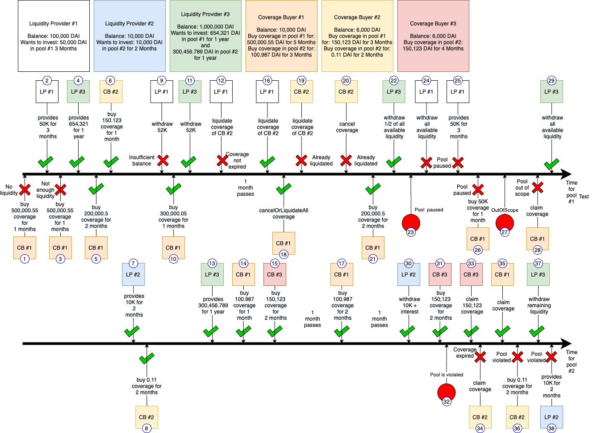

### Testing Type

-   Unit Testing
    -   Unit Testing 通常是指完整、獨立地測試每一個部件，在給定各種輸入的情況下和預期的輸出要相符。在測試的過程中通常不會考慮其他部件的影響，在 Solidity 撰寫的 Smat Contract 中，部件通常指的是每一個 Function。
    -   需要注意的輸入有：
        -   邊際測資
            -   空字串、bound(e.g. 0, min, max, 2^256, -2^128...)
        -   極端測資
            -   超長的輸入
        -   特殊測資
            -   含有特殊字元的輸入
-   Integration Testing
    -   將許多個 Unit 組合之後一起進行測試，確保這些部件無論是：
        -   在一起隨機運作
        -   有特定目的運作
        -   或甚至模擬特定情況的運作，都是正確無誤的。
    -   除了隨機交互作用之外，模擬的情況可能有：Owner Operation、WhiteList Operation、User Operation 等。
-   Regression Testing
    -   以迴歸的方式來對版本重測，確定舊版本 Bug 於修正後不會在新版本中出現。
-   Stress Testing
    -   嘗試去模擬現實世界的運行流，通常會有多個使用者隨機操作產品，也會有不同地方的 Provider，這樣可以去測試系統中是否有 Deadlock 的發生，或者不正常甚至不斷重複呼叫某一個功能的情況。
    -   範例圖片[出處](https://quantstamp.com/blog/securing-your-defi-project-starts-with-quality-testing)

-   Security Tests
    -   針對特定攻擊或者目的進行預防測試，例如重送攻擊、閃電貸等。
