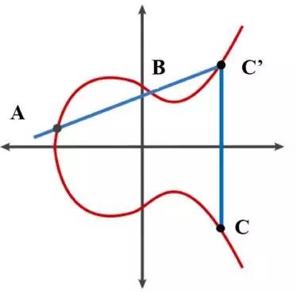
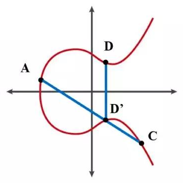
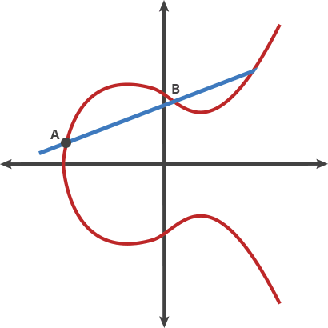
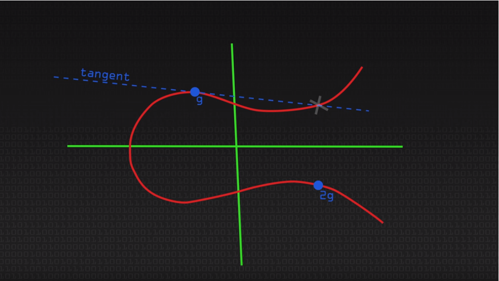
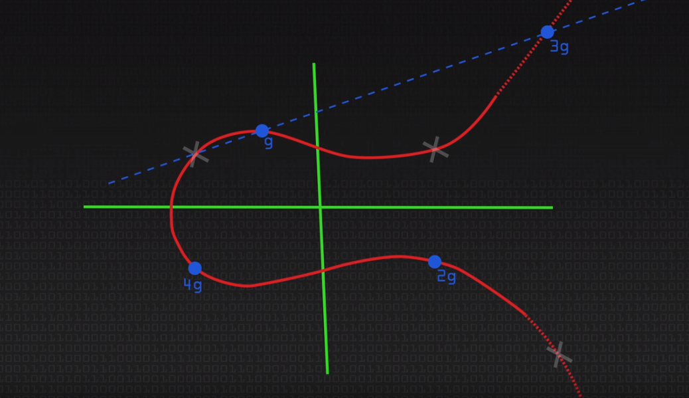
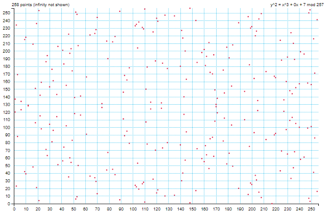
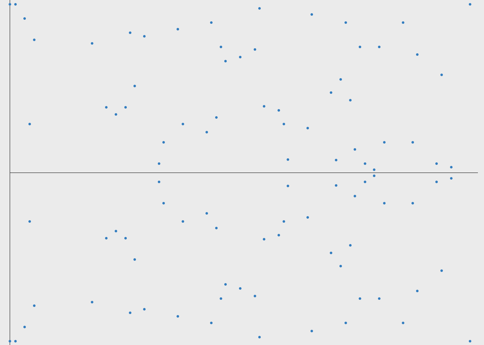

## Intro

A + B = C



A + C = D



ECC 可以比 RSA 使用更小的密鑰長度就可以達到相似的安全性，ESDSA 的方程式為 y² = x³ + ax + b



### Elliptic Curve Cryptography

Assume

-   A == B ⇒ g (generator)
-   A + B = C ⇒ g + g = 2g



Assume

-   A == B ⇒ g (generator)
-   A + B = C ⇒ g + g = 2g
-   2g + g = 3g



### PK

Pk = n\*g

-   Pk : public key
-   n : private key
-   g : generator

secp256k1 over the field ²⁸+1



Point multiplication demonstrated in a finite field

> Since the number of available points is linearly related to the field size (number of points = Fᵖ +1), and since there is no easy way to find n given P and Q, you just have to go through the whole list, trying 115792089237316195423570985008687907853269984665640564039457584007908834671663–1 possibilities to find it.



## Class

-   ECDSA: Elliptic Curve Digital Signature Algorithm
    -   sign(msg) -- > (r, s)
    -   sign(msg) -- > (r, s, v): [簡單聊聊 ECDSA 與 Ethereum 的 sign message](https://kimiwu.medium.com/%E7%B0%A1%E5%96%AE%E8%81%8A%E8%81%8Aecdsa%E8%88%87ethereum%E7%9A%84sign-message-7a8e79d185c4)
    -   e.g. Secp256k1
    -   [ECDSA sample](https://kjur.github.io/jsrsasign/sample/sample-ecdsa.html)
-   EdDSA
    -   e.g. Ed25519, Jubjub
-   ECDH: Elliptic Curve Diffie–Hellman Key Exchange
    -   s : secret
    -   s = na \* Pkb = na \* (nb \* g) = nb \* Pka

```
當簽名算出的 （x, y) = k*G
r = x
當 y 座標是偶數的時候，v = 27; 反之為 28 
那為什麼要這樣設計，試想橢圓曲線上，取同一個 x 座標，會有兩個點，一個 y 一個 -y 

只有在固定 y 下，我們才能夠得到同一個公鑰；不然可能會對到兩個地址，那個 V 就是一個限定是那個座標的用法而已
微補充：
(1) 正負 y 同義於奇偶 y under modulo prime p，因為 p 是奇數，所以負 y 同餘 p-y 同餘偶 y
(2) Bitcoin 直接規定 address 如果是 0x02 開頭就是取偶y，0x03 開頭取奇 y，0x04 開頭則是 x y 並列的未壓縮格式
```

## Reference

-   [Elliptic Curves Number Theory and Cryptography](https://people.cs.nctu.edu.tw/%7Erjchen/ECC2012S/Elliptic%20Curves%20Number%20Theory%20And%20Cryptography%202n.pdf)
-   [\[Mirror\] Exploring Elliptic Curve Pairings](https://vitalik.ca/general/2017/01/14/exploring_ecp.html)
-   [Bitcoin](https://github.com/linkinbird/blockchain_book/blob/master/blockchain%20study%20note.md)
-   [go-ethereum/accounts/key.go](https://github.com/ethereum/go-ethereum/blob/fed692f67e81bd3937a5efab38f56a9b99d04d41/accounts/key.go)
-   [wizardofozzie/pybitcointools](https://github.com/wizardofozzie/pybitcointools/blob/9f79e2aa967a5c10a5a8ba16030c9b6fe0388c0e/bitcoin/main.py#L541-L542)
-   [Understanding Ethereum Cryptography](https://betterprogramming.pub/understanding-ethereum-cryptography-3ef7429eddce)
-   [noble-secp256k1](https://github.com/paulmillr/noble-secp256k1)
-   [Understanding How ECDSA Protects Your Data.](https://www.instructables.com/Understanding-how-ECDSA-protects-your-data/)

-   [Sage and Elliptic Curves: P256 and secp256k1](https://medium.com/asecuritysite-when-bob-met-alice/sage-and-elliptic-curves-p256-and-secp256k1-e21fb0be3677)
-   [Threshold ECDSA Using GG20](https://medium.com/asecuritysite-when-bob-met-alice/threshold-ecdsa-using-gg20-61074f39d8c8)
-   [Crypto Magic: Recovering Alice’s Public Key From An ECDSA Signature](https://medium.com/asecuritysite-when-bob-met-alice/crypto-magic-recovering-alices-public-key-from-an-ecdsa-signature-e7193df8df6e)
-   [ECDSA and EdDSA](./ecdsa.md)
