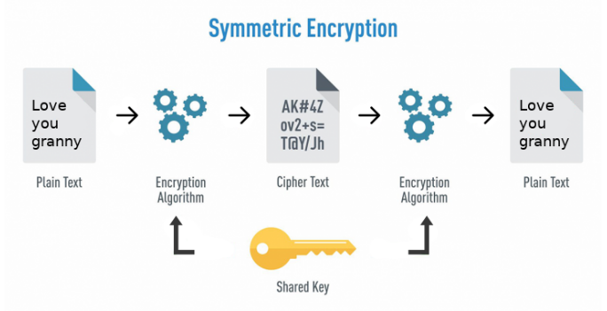
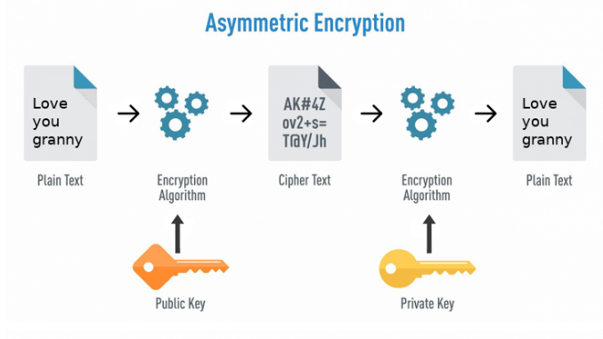

Symmetric → AES

Asymmetric → RSA, ECC

* * *

-   [Ethereum signatures for hackers and auditors 101](https://medium.com/coinmonks/ethereum-signatures-for-hackers-and-auditors-101-4da766cd6344)
-   [Homomorphic Signatures](https://medium.com/iovlabs-innovation-stories/homomorphic-signatures-a6659a376185)
-   [Signature Malleability Vulnerabilities in Smart Contracts](https://medium.com/cryptogennepal/signature-malleability-vulnerabilities-in-smart-contract-ae7fb4374a37)
-   [Signing and Verifying Ethereum Messages](https://medium.com/@kaishinaw/signing-and-verifying-ethereum-messages-f5acd41ca1a8)
