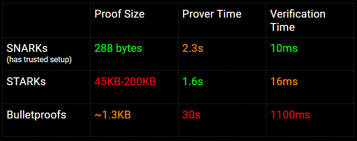

Zero Knowledge Proof(ZKP)，中文為零知識證明。意指為當我們具有某種知識或知曉某些資訊時（證明某命題），我們可以在不提供資訊/知識本身（只須證明命題為真，不需要其他行為），就可以說服他人我們知曉。

-   [\[MIT IAP 2023\] Modern Zero Knowledge Cryptography](https://zkiap.com/)
-   [开一个threads记录我学习ZKP的过程和心](https://twitter.com/0xstan_/status/1610301714632159234?s=53&t=XZlm7g3TmlMI-GyZzpkh3Q)

-   [Demystifying Zero Knowledge Proofs \[FINAL\]](https://docs.google.com/presentation/d/1gfB6WZMvM9mmDKofFibIgsyYShdf0RV_Y8TLz3k1Ls0/edit#slide=id.g443ebc39b4_0_110)
-   [Get Started with Zero-Knowledge Proof — Blockchain Roadmap](https://medium.com/@buraktahtacioglu/get-started-with-zero-knowledge-proof-blockchain-roadmap-f82843316b39)
-   [ZK Research](https://0xst.notion.site/ZK-Research-94ba836c3b2a4e2491a871364ee5b13b)
-   [ingonyama-zk/ingopedia](https://github.com/ingonyama-zk/ingopedia)
-   [Episode 133: Trusted Setup Ceremonies Explored](https://zeroknowledge.fm/133-2/)
-   [Kate Commitments: A Primer](https://hackmd.io/@tompocock/Hk2A7BD6U)
-   [The Power of Tau or: How I Learned to Stop Worrying and Love the Setup](https://zeroknowledge.fm/the-power-of-tau-or-how-i-learned-to-stop-worrying-and-love-the-setup/)
-   [Why and How zk-SNARK Works 2: Proving Knowledge of a Polynomial](https://medium.com/@imolfar/why-and-how-zk-snark-works-2-proving-knowledge-of-a-polynomial-f817760e2805)

### Awesome List

-   [Awesome zero knowledge proofs (zkp)](https://github.com/matter-labs/awesome-zero-knowledge-proofs)
-   [appliedzkp](https://github.com/appliedzkp)
-   [Learning ZKPs: Beginner Resources](https://community.zeroknowledge.fm/t/learning-zkps-beginner-resources/302)
-   [Perama's notes.](https://perama-v.github.io/)

* * *

## Publication

-   [Privacy & Scaling Explorations](https://medium.com/privacy-scaling-explorations?_branch_referrer=H4sIAAAAAAAAA8soKSkottLXz8nMy9bLTU3JLM3VS87P1fdLi%2FCIzMsvCilKAgCrinGkIwAAAA%3D%3D)
-   [Mina: Using Zero-Knowledge To Make Web3 Useful for Everyone](https://blog.o1labs.org/mina-using-zero-knowledge-to-make-web3-useful-for-everyone-b0b1d0847417)

### 補充說明

-   SNARKs: ZCash, CODA, ZK-Rollup, Semaphore
-   STARKs: 0x(DEX)
-   Bulletproofs: Monero

* * *

### Paper

#### ZKP

-   [Lecture 15 - Zero Knowledge Proofs - Boaz Barak](https://www.cs.princeton.edu/courses/archive/fall07/cos433/lec15.pdf)
-   [Proofs, Arguments, and Zero-Knowledge1 - Justin Thaler2](https://people.cs.georgetown.edu/jthaler/ProofsArgsAndZK.pdf)
-   [Efficient Zero-Knowledge Proofs and Applications - Ryan Henry](https://core.ac.uk/download/pdf/144147582.pdf)
-   [Zero-Knowledge Proofs of Identity - Uriel Feige, Amos Fiat & Adi Shamir](https://link.springer.com/content/pdf/10.1007/BF02351717.pdf)
-   [Zero Knowledge Proofs And Application to Financial Regulation](https://dash.harvard.edu/bitstream/handle/1/38811528/GOWRAVARAM-SENIORTHESIS-2018.pdf?sequence=3&isAllowed=y)
-   [A study of Statistical Zero Knowledge Proofs - Salil Pravin Vadhan](https://people.seas.harvard.edu/%7Esalil/research/phdthesis.pdf)
-   Zero-Knowledge Proofs for Secure Computation
-   DEFINITIONS AND PROPERTIES OF ZERO-KNOWLEDGE PROOF SYSTEMS - Oded Goldreich & Yair Oren

## Others

-   [Zero-Knowledge-Proof Mining](https://medium.com/@zk.work/zero-knowledge-proof-mining-d83afe441cbf)
-   [Saving Gas When Implementing Circuits Into Smart Contracts](https://medium.com/@deenz/saving-gas-when-implementing-circuits-into-smart-contracts-e7e7bd039440)

* * *

Hacking exercises/Resources recommended for practice:

1.  https://docs.rs/ark-algebra-intro/0.3.0/ark\_algebra\_intro/
2.  https://youtu.be/\_Zcz4Y4yt1Q

QuickStarter:

1.  http://www.petkus.info/papers/WhyAndHowZkSnarkWorks.pdf
2.  https://hongchao.me/zksnark/

SoK: https://github.com/matter-labs/awesome-zero-knowledge-proofs https://github.com/ZKProofs/ZKProofs.github.io/blob/master/index.md https://community.zeroknowledge.fm/t/learning-zkps-beginner-resources/302

General:

1.  https://docs.zkproof.org/pages/reference/reference.pdf

Books:

1.  https://people.cs.georgetown.edu/jthaler/ProofsArgsAndZK.pdf

Courses:

1.  https://www.msri.org/summer\_schools/931
2.  https://www.youtube.com/playlist?list=PL8Vt-7cSFnw29cLUVqAIuMlg1QJ-szV0K

## Others

-   [ZK.WORK](https://zk.work/en)
