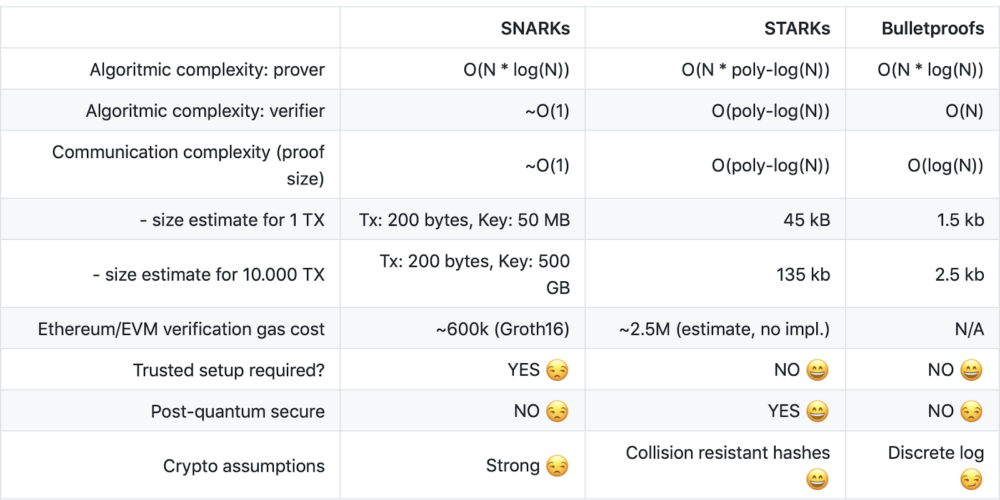

-   [Steven zk-SNARK](https://docs.google.com/presentation/d/13iPgc6W5iQC69P7-YS4Z8N9n0KcfgGWLkmXNEMm5Z00/edit#slide=id.g1602ff3033f_2_49)
-   [zk-SNARKs: A Gentle Introduction](https://www.di.ens.fr/%7Enitulesc/files/Survey-SNARKs.pdf)
-   [INTRODUCTION TO ZK-SNARKS: Ting-Yu Ye](https://hackmd.io/@TpKotoba/Slide_25Oct#/)
-   [Introduction to zk-SNARKs](https://consensys.net/blog/developers/introduction-to-zk-snarks/)
-   [A Guide to zk-SNARKs](https://minaprotocol.com/blog/a-guide-to-zk-snarks)
-   [Meet Pickles SNARK: Enabling Smart Contracts on Mina Protocol](https://medium.com/minaprotocol/meet-pickles-snark-enabling-smart-contract-on-coda-protocol-7ede3b54c250)
-   [Quadratic Arithmetic Programs: from Zero to Hero](https://medium.com/@VitalikButerin/quadratic-arithmetic-programs-from-zero-to-hero-f6d558cea649)
-   [深入瞭解 zk-SNARKs](https://medium.com/taipei-ethereum-meetup/%E6%B7%B1%E5%85%A5%E7%9E%AD%E8%A7%A3-zk-snarks-7a0187f399f1)

-   [Why and How zk-SNARK Works](https://arxiv.org/abs/1906.07221)
-   [Zero-knowledge proofs, a board game, and leaky abstractions: how I learned to write zk-SNARKs](https://weijiek.medium.com/how-i-learned-zk-snarks-from-scratch-177a01c5514e)
-   [Zero-Knowledge-Proof Mining](https://medium.com/6block/zero-knowledge-proof-mining-9bc12fbbbd55)
-   [ZK Poker — A Simple ZK-SNARK Circuit](https://medium.com/coinmonks/zk-poker-a-simple-zk-snark-circuit-8ec8d0c5ee52)

-   [Vitalik Buterin advises to pay attention to ZK-SNARK technology](https://medium.com/@unclefibonacci/vitalik-buterin-advises-to-pay-attention-to-zk-snark-technology-7c9af9f4cad2)
-   [Field selection for recursive SNARKs](https://medium.com/delendum/field-selection-for-recursive-snarks-726ad56c3a3c)
-   [An approximate introduction to how zk-SNARKs are possible](https://vitalik.ca/general/2021/01/26/snarks.html)
-   [zk-SNARK in a nutshell(1)](https://ieigen.medium.com/zk-snark-in-a-nutshell-1-e9119055539f)
-   [ZK-SNARK — A small introduction](https://medium.com/coinmonks/zk-snark-a-small-introduction-26f00284ba40)

### Trusted Setup

-   [Understanding zk-Snarks Trusted Setups](https://medium.com/@darlingtonnnam/understanding-zk-snarks-trusted-setups-8e2eb2ba2091)

### Book

-   [Proofs, Arguments, and Zero-Knowledge](https://people.cs.georgetown.edu/jthaler/ProofsArgsAndZK.html)
-   [CS294: Probabilistically Checkable and Interactive Proof Systems (S2019)](https://people.eecs.berkeley.edu/%7Ealexch/classes/CS294-S2019.html)
-   [The 9th BIU Winter School on Cryptography - Zero Knowledge](https://www.youtube.com/playlist?list=PL8Vt-7cSFnw29cLUVqAIuMlg1QJ-szV0K)

### Math

-   [\[Mirror\] Quadratic Arithmetic Programs: from Zero to Hero](https://vitalik.ca/general/2016/12/10/qap.html)

### Comparison

-   [Zero-Knowledge Proofs: STARKs vs SNARKs](https://consensys.net/blog/blockchain-explained/zero-knowledge-proofs-starks-vs-snarks/)

* * *

## O(1)Labs with inner product argument

-   [Inner Product Arguments](https://dankradfeist.de/ethereum/2021/07/27/inner-product-arguments.html)
-   [SNARKs love Hash Functions: Hashing (to Elliptic Curves) inside SNARKs - Rebekah Mercer (O(1)Labs)](https://www.youtube.com/watch?v=qWRUPzm3qPY&ab_channel=ZeroKnowledge)
-   [What is an inner product argument? Part 1](https://www.cryptologie.net/article/528/what-is-an-inner-product-argument-part-1/)
-   [Announcing the SnarkyJS Launch Partner Program](https://blog.o1labs.org/announcing-the-snarkyjs-launch-partner-program-5e7db549edb5)

* * *

## STARKs vs. SNARKs:

### zk-Snarks

consists of three algorithms `G`, `P`, V defined as follows:

The key generator G takes a secret parameter lambda and a program `C`, and generates two publicly available keys, a proving key `pk`, and a verification key `vk`. These keys are public parameters that only need to be generated once for a given program `C`.

The prover P takes as input the proving key `pk`, a public input x and a private witness `w`. The algorithm generates a proof prf = P(pk, x, w) that the prover knows a witness w and that the witness satisfies the program.

The verifier V computes V(vk, x, prf) which returns true if the proof is correct, and false otherwise. Thus this function returns true if the prover knows a witness w satisfying `C(x,w) == true`.

Note here the secret parameter lambda used in the generator. This parameter sometimes makes it tricky to use zk-SNARKs in real-world applications. The reason for this is that anyone who knows this parameter can generate fake proofs. Specifically, given any program C and public input x a person who knows lambda can generate a proof fake\_prf such that V(vk, x, fake\_prf) evaluates to true without knowledge of the secret `w`.

Thus actually running the generator requires a very secure process to make sure no-one learns about and saves the parameter anywhere. This was the reason for the extremely elaborate ceremony the Zcash team conducted in order to generate the proving key and verification key, while making sure the “toxic waste” parameter lambda was destroyed in the process.

### zk-Starks

### STARKs vs. SNARKs

zk-SNARKs（Succinct Non-interactive Argument of Knowledge， 即「零知識簡潔非交互式知識論證」）於 2012 年首次提出並在不久之後實施，為該技術贏得了先發優勢。

簡潔性意味著生成的證明足夠小，因此即使證明的內容很複雜，驗證所耗費的時間也不長；非交互性指的是驗證者不需要通過與證明者互動，來驗證 ZK 證明，並且可能會在受信任的初始設置中產生一段可以被用來製作假證明的「有毒垃圾」數據。

相比之下，zk-STARKs（Scalable Transparent Argument of Knowledge， 即「零知識可擴展的透明知識論證」）是一項由 StarkWare 團隊於 2018 年推出的、相對較新的技術。 Zk-STARKs 有兩個主要優勢：

zk-STARK 算法的運算過程是公開透明，並沒有 ZK-SNARK 中受信任的初始設置，因此消除了產生「有毒垃圾」的可能 可擴展 – 證明時間與證明內容的複雜性呈擬線性關係，而驗證時間則與其呈多對數關係，因此，當證明內容的複雜性顯著增加時，儘管鏈下證明的耗時也擬線性增長，鏈上驗證的耗時卻增加不大。

然而，和 zk-SNARK 相比，zk-STARKs 生成的加密證明的尺寸要大得多。此外，以太坊有針對特定 zk-SNARK 的預編譯，因此，驗證 zk-SNARK 加密證明的 gas 成本要低於 zk-STARK。

Both are acronyms for the method by which the two parties prove their knowledge: zk-STARK stands for zero-knowledge scalable transparent argument of knowledge, and zk-SNARK stands for zero-knowledge succinct non-interactive argument of knowledge.

This post will delve into the core differences between these two different zero-knowledge technologies, both from a cultural and technical perspective.

Furthermore, both of these zero-knowledge technologies are non-interactive by nature, meaning the code can be deployed and act autonomously.

> Source: [Matter Labs/awesome-zero-knowledge-proofs](https://github.com/matter-labs/awesome-zero-knowledge-proofs#comparison-of-the-most-popular-zkp-systems)

### Resource

zk-Snarks

-   [Introduction to zk-SNARKs](https://consensys.net/blog/developers/introduction-to-zk-snarks/)
-   [A Guide to zk-SNARKs](https://minaprotocol.com/blog/a-guide-to-zk-snarks)
-   [深入瞭解 zk-SNARKs](https://medium.com/taipei-ethereum-meetup/%E6%B7%B1%E5%85%A5%E7%9E%AD%E8%A7%A3-zk-snarks-7a0187f399f1)

zk-Starks

-   [瞭解神秘的 ZK-STARKs](https://medium.com/taipei-ethereum-meetup/%E7%9E%AD%E8%A7%A3%E7%A5%9E%E7%A7%98%E7%9A%84-zk-starks-ee56a697af76)
-   [ZK-STARK 證明系統](https://trapdoor-tech.github.io/zkstark-book/chapter_1.html)
