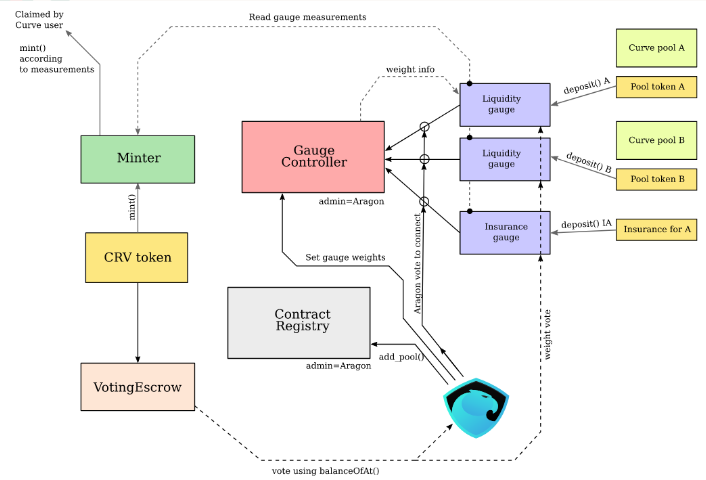

Curve 是一個流動性提供平台，其為了區分流動池的好壞而把相似類別的 Token 去做交換，讓無償性損失也可以是利潤來源。此外，Curve 也 有自己的治理代幣 CRV，去執行投票、質押（利用 veCRV）等權利，且用戶甚至可以利用投票去決定利率。然而 Convex 以提供更高獎勵的方式（給予 CRV 及 Convex 治理幣 CVX ）來吸引 Curve 用戶將 CRV質押到 Convex 上，並藉此獲得大量的 CRV 來執行 Curve 的代理權，進而掌握控制 Curve 利率的權力。透過掌握其他平台的流動性，Convex 解決了流動性短暫且不穩定的問題，即為 DeFi 2.0 最重要的進步。

### Formula

-   Voting Power = Lock Value \* Lock Period / Max Lock Period
-   Working Balance = min(user LP, 0.4 \* user LP + 0.6 \* total LP \* user veCRV / gauge veCRV)
-   optimal at "user LP / total LP = user veCRV / gauge veCRV"

### Governmance

治理權與受益權分離：

-   CRV -> cvxCRV
-   CVX -> vlCVX

本質上是對 Curve 治理的破壞，但對價格有利 🤑🤑🤑

## System Design

* * *

## Closing

### Reference

-   [Curve Stablecoin 非權威解讀](https://paco0x.org/curve-stablecoin/)
-   [How to Integrate the Curve.Fi Protocol Into Your DeFi Protocol](https://betterprogramming.pub/how-to-integrate-the-curve-fi-protocol-into-your-defi-protocol-e1d4c43f716d)

* * *

> 最後歡迎大家拍打餵食大學生[`0x2b83c71A59b926137D3E1f37EF20394d0495d72d`](https://etherscan.io/address/0x2b83c71A59b926137D3E1f37EF20394d0495d72d)
