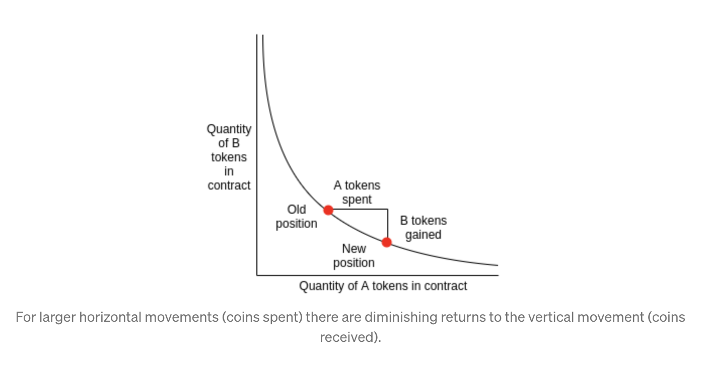

## Intro.

### Exchange Mode

交易所運作模式分為兩種：

1.  **Order book model:** 買家和賣家分別掛單，由中心化交易所來搓合，常常適用於傳統股票交易所
2.  **Automated market makers (AMM):** 沒有中間的搓合商，種主要由一些人作為 Liquidity Providers 提供兩種幣，這些幣會進入各自幣種的 Liquidity Pool，此後買家可以藉由這個池子來利用一種幣換取另一種幣。

### DEX

* * *

## AMM

Uniswap 採用的是 AMM 機制，

-   [Understanding Automated Market-Makers, Part 1: Price Impact](https://research.paradigm.xyz/amm-price-impact)

### Impermanant Loss

### Solidity by Example

-   [Constant Sum AMM](https://solidity-by-example.org/defi/constant-sum-amm)
-   [Constant Product AMM(For Uniswap)](https://solidity-by-example.org/defi/constant-product-amm)
-   [Stable Swap AMM(For Curve)](https://solidity-by-example.org/defi/stable-swap-amm)

* * *

## Contract Design

* * *

## Closing

### Reference

#### DEX Breakdown

-   [Introducing: Swaap Protocol](https://medium.com/swaap-finance/introducing-swaap-protocol-ab732a947d5d)
-   [Dex contracts](https://medium.com/coinmonks/dex-contracts-20e11ed52ef7)

* * *

> 最後歡迎大家拍打餵食大學生[`0x2b83c71A59b926137D3E1f37EF20394d0495d72d`](https://etherscan.io/address/0x2b83c71A59b926137D3E1f37EF20394d0495d72d)
