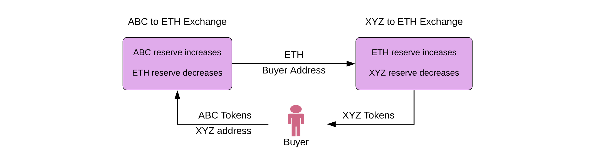

## Version 1

### Features

-   Add support for any ERC20 token using the Uniswap [factory](https://github.com/Uniswap/contracts-vyper/blob/master/contracts/uniswap_factory.vy)
-   [Join liquidity pools](https://defi-development-breakdown.web.app/DEX/uniswap/frontend-integration/pool.html#add-liquidity) to collect fees on ETH-ERC20 pairs
-   Liquidity-sensitive automated pricing using [constant product formula](https://github.com/runtimeverification/verified-smart-contracts/blob/uniswap/uniswap/x-y-k.pdf)
-   Trade [ETH for any ERC20](https://defi-development-breakdown.web.app/DEX/uniswap/frontend-integration/swap.html#eth-erc20-trades) without wrapping
-   Trade any [ERC20 for any ERC20](https://defi-development-breakdown.web.app/DEX/uniswap/frontend-integration/swap.html#erc20-to-erc20) in a single transaction
-   Trade and transfer to a different address in a single transaction
-   Lowest gas cost of any decentralized exchange
-   Support for private and custom uniswap exchanges
-   Buy ERC20 tokens from any wallet using ENS
-   [Partially verified](https://github.com/runtimeverification/verified-smart-contracts/tree/uniswap/uniswap) smart contracts written in Vyper
-   Mobile-optimized open source [frontend implementation](https://github.com/Uniswap/uniswap-frontend)
-   Funded through an [Ethereum Foundation grant](https://blog.ethereum.org/2018/08/17/ethereum-foundation-grants-update-wave-3/)

### Comparisons

-   [Differences between Uniswap versions](https://ilamanov.medium.com/difference-between-uniswap-versions-877619a5bce2)

* * *

## Contract Breakdown

Uniswap V1 的合約主要分為兩個主軸：[`uniswap_factory.vy`](https://github.com/Uniswap/v1-contracts/blob/master/contracts/uniswap_factory.vy) 和 [`uniswap_exchange.vy`](https://github.com/Uniswap/v1-contracts/blob/master/contracts/uniswap_exchange.vy)，接下來會針對程式碼做詳細的介紹。

### Factory: Creating Exchanges

`uniswap_factory.vy` 中最主要的功能便是可以讓所有使用者建立一個之前沒有過的交易對，在 `createExchange()` 這個 Function 中針對每一個幣種的 `token_to_exchange` 和 `exchange_to_token` 分別指向對方幣種，並利用 `id_to_token` 和 `tokenCount`、`token_id` 來加速紀錄當前幣種的編號。

```python
contract Exchange():
    def setup(token_addr: address): modifying

NewExchange: event({token: indexed(address), exchange: indexed(address)})

exchangeTemplate: public(address)
tokenCount: public(uint256)
token_to_exchange: address[address]
exchange_to_token: address[address]
id_to_token: address[uint256]

@public
def initializeFactory(template: address):
    assert self.exchangeTemplate == ZERO_ADDRESS
    assert template != ZERO_ADDRESS
    self.exchangeTemplate = template

@public
def createExchange(token: address) -> address:
    assert token != ZERO_ADDRESS
    assert self.exchangeTemplate != ZERO_ADDRESS
    assert self.token_to_exchange[token] == ZERO_ADDRESS
    exchange: address = create_with_code_of(self.exchangeTemplate)
    Exchange(exchange).setup(token)
    self.token_to_exchange[token] = exchange
    self.exchange_to_token[exchange] = token
    token_id: uint256 = self.tokenCount + 1
    self.tokenCount = token_id
    self.id_to_token[token_id] = token
    log.NewExchange(token, exchange)
    return exchange
```

接下來便是一連串的 Getter Function。

```python
@public
@constant
def getExchange(token: address) -> address:
    return self.token_to_exchange[token]

@public
@constant
def getToken(exchange: address) -> address:
    return self.exchange_to_token[exchange]

@public
@constant
def getTokenWithId(token_id: uint256) -> address:
    return self.id_to_token[token_id]
```

根據白皮書，V1 的 Factory 並沒有確認當前幣種的安全性和相關正確性，由於任何人都可以新增交易對，所以用戶在使用上必須自行確認交易對的幣種是否是自己想要的。

* * *

## Exchange: Swap & Liquidity Implementation

接下來都是在 `uniswap_exchange.vy` 之中：

### Constructor and Setup

```python
# @title Uniswap Exchange Interface V1
# @notice Source code found at https://github.com/uniswap
# @notice Use at your own risk

contract Factory():
    def getExchange(token_addr: address) -> address: constant

contract Exchange():
    def getEthToTokenOutputPrice(tokens_bought: uint256) -> uint256(wei): constant
    def ethToTokenTransferInput(min_tokens: uint256, deadline: timestamp, recipient: address) -> uint256: modifying
    def ethToTokenTransferOutput(tokens_bought: uint256, deadline: timestamp, recipient: address) -> uint256(wei): modifying

TokenPurchase: event({buyer: indexed(address), eth_sold: indexed(uint256(wei)), tokens_bought: indexed(uint256)})
EthPurchase: event({buyer: indexed(address), tokens_sold: indexed(uint256), eth_bought: indexed(uint256(wei))})
AddLiquidity: event({provider: indexed(address), eth_amount: indexed(uint256(wei)), token_amount: indexed(uint256)})
RemoveLiquidity: event({provider: indexed(address), eth_amount: indexed(uint256(wei)), token_amount: indexed(uint256)})
Transfer: event({_from: indexed(address), _to: indexed(address), _value: uint256})
Approval: event({_owner: indexed(address), _spender: indexed(address), _value: uint256})

name: public(bytes32)                             # Uniswap V1
symbol: public(bytes32)                           # UNI-V1
decimals: public(uint256)                         # 18
totalSupply: public(uint256)                      # total number of UNI in existence
balances: uint256[address]                        # UNI balance of an address
allowances: (uint256[address])[address]           # UNI allowance of one address on another
token: address(ERC20)                             # address of the ERC20 token traded on this contract
factory: Factory                                  # interface for the factory that created this contract

# @dev This function acts as a contract constructor which is not currently supported in contracts deployed
#      using create_with_code_of(). It is called once by the factory during contract creation.
@public
def setup(token_addr: address):
    assert (self.factory == ZERO_ADDRESS and self.token == ZERO_ADDRESS) and token_addr != ZERO_ADDRESS
    self.factory = msg.sender
    self.token = token_addr
    self.name = 0x556e697377617020563100000000000000000000000000000000000000000000
    self.symbol = 0x554e492d56310000000000000000000000000000000000000000000000000000
    self.decimals = 18
```

### ETH ⇄ ERC20 Trades

這組交易對有兩種情形，但都符合 `eth_pool * token_pool = invariant` 的公式運作，當我們想要：

-   以 ETH 換取 ERC20 時，會將 ETH 存入 eth\_pool 中，此時 token\_pool 就會隨之降低
    -   `new_eth_pool: uint256 = self.eth_pool + msg.value`
    -   `new_token_pool: uint256 = invariant / (new_eth_pool - fee)`
-   以 ERC20 換取 ETH 時，會將 token\_pool 提高，eth\_pool 會隨之降低
    -   `new_token_pool: uint256 = self.token_pool + tokens_in`
    -   `new_eth_pool: uint256 = self.invariant / (new_token_pool - fee)`

以上這些動作將會導致 Reserve Ratio Shifts

```python
# @dev Pricing function for converting between ETH and Tokens.
# @param input_amount Amount of ETH or Tokens being sold.
# @param input_reserve Amount of ETH or Tokens (input type) in exchange reserves.
# @param output_reserve Amount of ETH or Tokens (output type) in exchange reserves.
# @return Amount of ETH or Tokens bought.
@private
@constant
def getInputPrice(input_amount: uint256, input_reserve: uint256, output_reserve: uint256) -> uint256:
    assert input_reserve > 0 and output_reserve > 0
    input_amount_with_fee: uint256 = input_amount * 997
    numerator: uint256 = input_amount_with_fee * output_reserve
    denominator: uint256 = (input_reserve * 1000) + input_amount_with_fee
    return numerator / denominator

# @dev Pricing function for converting between ETH and Tokens.
# @param output_amount Amount of ETH or Tokens being bought.
# @param input_reserve Amount of ETH or Tokens (input type) in exchange reserves.
# @param output_reserve Amount of ETH or Tokens (output type) in exchange reserves.
# @return Amount of ETH or Tokens sold.
@private
@constant
def getOutputPrice(output_amount: uint256, input_reserve: uint256, output_reserve: uint256) -> uint256:
    assert input_reserve > 0 and output_reserve > 0
    numerator: uint256 = input_reserve * output_amount * 1000
    denominator: uint256 = (output_reserve - output_amount) * 997
    return numerator / denominator + 1

@private
def ethToTokenInput(eth_sold: uint256(wei), min_tokens: uint256, deadline: timestamp, buyer: address, recipient: address) -> uint256:
    assert deadline >= block.timestamp and (eth_sold > 0 and min_tokens > 0)
    token_reserve: uint256 = self.token.balanceOf(self)
    tokens_bought: uint256 = self.getInputPrice(as_unitless_number(eth_sold), as_unitless_number(self.balance - eth_sold), token_reserve)
    assert tokens_bought >= min_tokens
    assert self.token.transfer(recipient, tokens_bought)
    log.TokenPurchase(buyer, eth_sold, tokens_bought)
    return tokens_bought

# @notice Convert ETH to Tokens.
# @dev User specifies exact input (msg.value).
# @dev User cannot specify minimum output or deadline.
@public
@payable
def __default__():
    self.ethToTokenInput(msg.value, 1, block.timestamp, msg.sender, msg.sender)

# @notice Convert ETH to Tokens.
# @dev User specifies exact input (msg.value) and minimum output.
# @param min_tokens Minimum Tokens bought.
# @param deadline Time after which this transaction can no longer be executed.
# @return Amount of Tokens bought.
@public
@payable
def ethToTokenSwapInput(min_tokens: uint256, deadline: timestamp) -> uint256:
    return self.ethToTokenInput(msg.value, min_tokens, deadline, msg.sender, msg.sender)

# @notice Convert ETH to Tokens and transfers Tokens to recipient.
# @dev User specifies exact input (msg.value) and minimum output
# @param min_tokens Minimum Tokens bought.
# @param deadline Time after which this transaction can no longer be executed.
# @param recipient The address that receives output Tokens.
# @return Amount of Tokens bought.
@public
@payable
def ethToTokenTransferInput(min_tokens: uint256, deadline: timestamp, recipient: address) -> uint256:
    assert recipient != self and recipient != ZERO_ADDRESS
    return self.ethToTokenInput(msg.value, min_tokens, deadline, msg.sender, recipient)

@private
def ethToTokenOutput(tokens_bought: uint256, max_eth: uint256(wei), deadline: timestamp, buyer: address, recipient: address) -> uint256(wei):
    assert deadline >= block.timestamp and (tokens_bought > 0 and max_eth > 0)
    token_reserve: uint256 = self.token.balanceOf(self)
    eth_sold: uint256 = self.getOutputPrice(tokens_bought, as_unitless_number(self.balance - max_eth), token_reserve)
    # Throws if eth_sold > max_eth
    eth_refund: uint256(wei) = max_eth - as_wei_value(eth_sold, 'wei')
    if eth_refund > 0:
        send(buyer, eth_refund)
    assert self.token.transfer(recipient, tokens_bought)
    log.TokenPurchase(buyer, as_wei_value(eth_sold, 'wei'), tokens_bought)
    return as_wei_value(eth_sold, 'wei')

# @notice Convert ETH to Tokens.
# @dev User specifies maximum input (msg.value) and exact output.
# @param tokens_bought Amount of tokens bought.
# @param deadline Time after which this transaction can no longer be executed.
# @return Amount of ETH sold.
@public
@payable
def ethToTokenSwapOutput(tokens_bought: uint256, deadline: timestamp) -> uint256(wei):
    return self.ethToTokenOutput(tokens_bought, msg.value, deadline, msg.sender, msg.sender)

# @notice Convert ETH to Tokens and transfers Tokens to recipient.
# @dev User specifies maximum input (msg.value) and exact output.
# @param tokens_bought Amount of tokens bought.
# @param deadline Time after which this transaction can no longer be executed.
# @param recipient The address that receives output Tokens.
# @return Amount of ETH sold.
@public
@payable
def ethToTokenTransferOutput(tokens_bought: uint256, deadline: timestamp, recipient: address) -> uint256(wei):
    assert recipient != self and recipient != ZERO_ADDRESS
    return self.ethToTokenOutput(tokens_bought, msg.value, deadline, msg.sender, recipient)

@private
def tokenToEthInput(tokens_sold: uint256, min_eth: uint256(wei), deadline: timestamp, buyer: address, recipient: address) -> uint256(wei):
    assert deadline >= block.timestamp and (tokens_sold > 0 and min_eth > 0)
    token_reserve: uint256 = self.token.balanceOf(self)
    eth_bought: uint256 = self.getInputPrice(tokens_sold, token_reserve, as_unitless_number(self.balance))
    wei_bought: uint256(wei) = as_wei_value(eth_bought, 'wei')
    assert wei_bought >= min_eth
    send(recipient, wei_bought)
    assert self.token.transferFrom(buyer, self, tokens_sold)
    log.EthPurchase(buyer, tokens_sold, wei_bought)
    return wei_bought

# @notice Convert Tokens to ETH.
# @dev User specifies exact input and minimum output.
# @param tokens_sold Amount of Tokens sold.
# @param min_eth Minimum ETH purchased.
# @param deadline Time after which this transaction can no longer be executed.
# @return Amount of ETH bought.
@public
def tokenToEthSwapInput(tokens_sold: uint256, min_eth: uint256(wei), deadline: timestamp) -> uint256(wei):
    return self.tokenToEthInput(tokens_sold, min_eth, deadline, msg.sender, msg.sender)

# @notice Convert Tokens to ETH and transfers ETH to recipient.
# @dev User specifies exact input and minimum output.
# @param tokens_sold Amount of Tokens sold.
# @param min_eth Minimum ETH purchased.
# @param deadline Time after which this transaction can no longer be executed.
# @param recipient The address that receives output ETH.
# @return Amount of ETH bought.
@public
def tokenToEthTransferInput(tokens_sold: uint256, min_eth: uint256(wei), deadline: timestamp, recipient: address) -> uint256(wei):
    assert recipient != self and recipient != ZERO_ADDRESS
    return self.tokenToEthInput(tokens_sold, min_eth, deadline, msg.sender, recipient)

@private
def tokenToEthOutput(eth_bought: uint256(wei), max_tokens: uint256, deadline: timestamp, buyer: address, recipient: address) -> uint256:
    assert deadline >= block.timestamp and eth_bought > 0
    token_reserve: uint256 = self.token.balanceOf(self)
    tokens_sold: uint256 = self.getOutputPrice(as_unitless_number(eth_bought), token_reserve, as_unitless_number(self.balance))
    # tokens sold is always > 0
    assert max_tokens >= tokens_sold
    send(recipient, eth_bought)
    assert self.token.transferFrom(buyer, self, tokens_sold)
    log.EthPurchase(buyer, tokens_sold, eth_bought)
    return tokens_sold

# @notice Convert Tokens to ETH.
# @dev User specifies maximum input and exact output.
# @param eth_bought Amount of ETH purchased.
# @param max_tokens Maximum Tokens sold.
# @param deadline Time after which this transaction can no longer be executed.
# @return Amount of Tokens sold.
@public
def tokenToEthSwapOutput(eth_bought: uint256(wei), max_tokens: uint256, deadline: timestamp) -> uint256:
    return self.tokenToEthOutput(eth_bought, max_tokens, deadline, msg.sender, msg.sender)

# @notice Convert Tokens to ETH and transfers ETH to recipient.
# @dev User specifies maximum input and exact output.
# @param eth_bought Amount of ETH purchased.
# @param max_tokens Maximum Tokens sold.
# @param deadline Time after which this transaction can no longer be executed.
# @param recipient The address that receives output ETH.
# @return Amount of Tokens sold.
@public
def tokenToEthTransferOutput(eth_bought: uint256(wei), max_tokens: uint256, deadline: timestamp, recipient: address) -> uint256:
    assert recipient != self and recipient != ZERO_ADDRESS
    return self.tokenToEthOutput(eth_bought, max_tokens, deadline, msg.sender, recipient)
```

### ERC20 ⇄ ERC20 Trades

在 Uniswap V1 中，我們可以發現 ERC20 to ERC20 swaps 會以 ETH 作為中介，下圖例子中如果我們要以 ABC 幣換 XYZ 幣，那就需要呼叫 ABC exchange Contract 中的 `tokenToTokenSwap()`，在經過一系列的 Check 和計算之後，這個 Function 會呼叫（internal call） XYZ exchange Contract 中的 payable function `ethToTokenTransfer()`。

`ethToTokenTransfer()` 在收到 Buyer Address 和 ETH 之後，一樣會經過計算和確認，最後利用 ERC20 的 `transfer()` 進行 Token 交易。



> `ethToTokenTransfer()` 比 `ethToTokenSwap()` 多了一個參數 `recipient: address`，其他部分的作用一模一樣。因為我們沒辦法使用 `msg.sender` 來判斷 Buyer 是誰，在這裡當我們以 ABC Contract 去呼叫 XYZ Contract 時，`msg.sender` 會是 ABC Contract Address 而不是 EOA Buyer。

```python
@private
def tokenToTokenInput(tokens_sold: uint256, min_tokens_bought: uint256, min_eth_bought: uint256(wei), deadline: timestamp, buyer: address, recipient: address, exchange_addr: address) -> uint256:
    assert (deadline >= block.timestamp and tokens_sold > 0) and (min_tokens_bought > 0 and min_eth_bought > 0)
    assert exchange_addr != self and exchange_addr != ZERO_ADDRESS
    token_reserve: uint256 = self.token.balanceOf(self)
    eth_bought: uint256 = self.getInputPrice(tokens_sold, token_reserve, as_unitless_number(self.balance))
    wei_bought: uint256(wei) = as_wei_value(eth_bought, 'wei')
    assert wei_bought >= min_eth_bought
    assert self.token.transferFrom(buyer, self, tokens_sold)
    tokens_bought: uint256 = Exchange(exchange_addr).ethToTokenTransferInput(min_tokens_bought, deadline, recipient, value=wei_bought)
    log.EthPurchase(buyer, tokens_sold, wei_bought)
    return tokens_bought

# @notice Convert Tokens (self.token) to Tokens (token_addr).
# @dev User specifies exact input and minimum output.
# @param tokens_sold Amount of Tokens sold.
# @param min_tokens_bought Minimum Tokens (token_addr) purchased.
# @param min_eth_bought Minimum ETH purchased as intermediary.
# @param deadline Time after which this transaction can no longer be executed.
# @param token_addr The address of the token being purchased.
# @return Amount of Tokens (token_addr) bought.
@public
def tokenToTokenSwapInput(tokens_sold: uint256, min_tokens_bought: uint256, min_eth_bought: uint256(wei), deadline: timestamp, token_addr: address) -> uint256:
    exchange_addr: address = self.factory.getExchange(token_addr)
    return self.tokenToTokenInput(tokens_sold, min_tokens_bought, min_eth_bought, deadline, msg.sender, msg.sender, exchange_addr)

# @notice Convert Tokens (self.token) to Tokens (token_addr) and transfers
#         Tokens (token_addr) to recipient.
# @dev User specifies exact input and minimum output.
# @param tokens_sold Amount of Tokens sold.
# @param min_tokens_bought Minimum Tokens (token_addr) purchased.
# @param min_eth_bought Minimum ETH purchased as intermediary.
# @param deadline Time after which this transaction can no longer be executed.
# @param recipient The address that receives output ETH.
# @param token_addr The address of the token being purchased.
# @return Amount of Tokens (token_addr) bought.
@public
def tokenToTokenTransferInput(tokens_sold: uint256, min_tokens_bought: uint256, min_eth_bought: uint256(wei), deadline: timestamp, recipient: address, token_addr: address) -> uint256:
    exchange_addr: address = self.factory.getExchange(token_addr)
    return self.tokenToTokenInput(tokens_sold, min_tokens_bought, min_eth_bought, deadline, msg.sender, recipient, exchange_addr)

@private
def tokenToTokenOutput(tokens_bought: uint256, max_tokens_sold: uint256, max_eth_sold: uint256(wei), deadline: timestamp, buyer: address, recipient: address, exchange_addr: address) -> uint256:
    assert deadline >= block.timestamp and (tokens_bought > 0 and max_eth_sold > 0)
    assert exchange_addr != self and exchange_addr != ZERO_ADDRESS
    eth_bought: uint256(wei) = Exchange(exchange_addr).getEthToTokenOutputPrice(tokens_bought)
    token_reserve: uint256 = self.token.balanceOf(self)
    tokens_sold: uint256 = self.getOutputPrice(as_unitless_number(eth_bought), token_reserve, as_unitless_number(self.balance))
    # tokens sold is always > 0
    assert max_tokens_sold >= tokens_sold and max_eth_sold >= eth_bought
    assert self.token.transferFrom(buyer, self, tokens_sold)
    eth_sold: uint256(wei) = Exchange(exchange_addr).ethToTokenTransferOutput(tokens_bought, deadline, recipient, value=eth_bought)
    log.EthPurchase(buyer, tokens_sold, eth_bought)
    return tokens_sold

# @notice Convert Tokens (self.token) to Tokens (token_addr).
# @dev User specifies maximum input and exact output.
# @param tokens_bought Amount of Tokens (token_addr) bought.
# @param max_tokens_sold Maximum Tokens (self.token) sold.
# @param max_eth_sold Maximum ETH purchased as intermediary.
# @param deadline Time after which this transaction can no longer be executed.
# @param token_addr The address of the token being purchased.
# @return Amount of Tokens (self.token) sold.
@public
def tokenToTokenSwapOutput(tokens_bought: uint256, max_tokens_sold: uint256, max_eth_sold: uint256(wei), deadline: timestamp, token_addr: address) -> uint256:
    exchange_addr: address = self.factory.getExchange(token_addr)
    return self.tokenToTokenOutput(tokens_bought, max_tokens_sold, max_eth_sold, deadline, msg.sender, msg.sender, exchange_addr)

# @notice Convert Tokens (self.token) to Tokens (token_addr) and transfers
#         Tokens (token_addr) to recipient.
# @dev User specifies maximum input and exact output.
# @param tokens_bought Amount of Tokens (token_addr) bought.
# @param max_tokens_sold Maximum Tokens (self.token) sold.
# @param max_eth_sold Maximum ETH purchased as intermediary.
# @param deadline Time after which this transaction can no longer be executed.
# @param recipient The address that receives output ETH.
# @param token_addr The address of the token being purchased.
# @return Amount of Tokens (self.token) sold.
@public
def tokenToTokenTransferOutput(tokens_bought: uint256, max_tokens_sold: uint256, max_eth_sold: uint256(wei), deadline: timestamp, recipient: address, token_addr: address) -> uint256:
    exchange_addr: address = self.factory.getExchange(token_addr)
    return self.tokenToTokenOutput(tokens_bought, max_tokens_sold, max_eth_sold, deadline, msg.sender, recipient, exchange_addr)

# @notice Convert Tokens (self.token) to Tokens (exchange_addr.token).
# @dev Allows trades through contracts that were not deployed from the same factory.
# @dev User specifies exact input and minimum output.
# @param tokens_sold Amount of Tokens sold.
# @param min_tokens_bought Minimum Tokens (token_addr) purchased.
# @param min_eth_bought Minimum ETH purchased as intermediary.
# @param deadline Time after which this transaction can no longer be executed.
# @param exchange_addr The address of the exchange for the token being purchased.
# @return Amount of Tokens (exchange_addr.token) bought.
@public
def tokenToExchangeSwapInput(tokens_sold: uint256, min_tokens_bought: uint256, min_eth_bought: uint256(wei), deadline: timestamp, exchange_addr: address) -> uint256:
    return self.tokenToTokenInput(tokens_sold, min_tokens_bought, min_eth_bought, deadline, msg.sender, msg.sender, exchange_addr)

# @notice Convert Tokens (self.token) to Tokens (exchange_addr.token) and transfers
#         Tokens (exchange_addr.token) to recipient.
# @dev Allows trades through contracts that were not deployed from the same factory.
# @dev User specifies exact input and minimum output.
# @param tokens_sold Amount of Tokens sold.
# @param min_tokens_bought Minimum Tokens (token_addr) purchased.
# @param min_eth_bought Minimum ETH purchased as intermediary.
# @param deadline Time after which this transaction can no longer be executed.
# @param recipient The address that receives output ETH.
# @param exchange_addr The address of the exchange for the token being purchased.
# @return Amount of Tokens (exchange_addr.token) bought.
@public
def tokenToExchangeTransferInput(tokens_sold: uint256, min_tokens_bought: uint256, min_eth_bought: uint256(wei), deadline: timestamp, recipient: address, exchange_addr: address) -> uint256:
    assert recipient != self
    return self.tokenToTokenInput(tokens_sold, min_tokens_bought, min_eth_bought, deadline, msg.sender, recipient, exchange_addr)

# @notice Convert Tokens (self.token) to Tokens (exchange_addr.token).
# @dev Allows trades through contracts that were not deployed from the same factory.
# @dev User specifies maximum input and exact output.
# @param tokens_bought Amount of Tokens (token_addr) bought.
# @param max_tokens_sold Maximum Tokens (self.token) sold.
# @param max_eth_sold Maximum ETH purchased as intermediary.
# @param deadline Time after which this transaction can no longer be executed.
# @param exchange_addr The address of the exchange for the token being purchased.
# @return Amount of Tokens (self.token) sold.
@public
def tokenToExchangeSwapOutput(tokens_bought: uint256, max_tokens_sold: uint256, max_eth_sold: uint256(wei), deadline: timestamp, exchange_addr: address) -> uint256:
    return self.tokenToTokenOutput(tokens_bought, max_tokens_sold, max_eth_sold, deadline, msg.sender, msg.sender, exchange_addr)

# @notice Convert Tokens (self.token) to Tokens (exchange_addr.token) and transfers
#         Tokens (exchange_addr.token) to recipient.
# @dev Allows trades through contracts that were not deployed from the same factory.
# @dev User specifies maximum input and exact output.
# @param tokens_bought Amount of Tokens (token_addr) bought.
# @param max_tokens_sold Maximum Tokens (self.token) sold.
# @param max_eth_sold Maximum ETH purchased as intermediary.
# @param deadline Time after which this transaction can no longer be executed.
# @param recipient The address that receives output ETH.
# @param token_addr The address of the token being purchased.
# @return Amount of Tokens (self.token) sold.
@public
def tokenToExchangeTransferOutput(tokens_bought: uint256, max_tokens_sold: uint256, max_eth_sold: uint256(wei), deadline: timestamp, recipient: address, exchange_addr: address) -> uint256:
    assert recipient != self
    return self.tokenToTokenOutput(tokens_bought, max_tokens_sold, max_eth_sold, deadline, msg.sender, recipient, exchange_addr)
```

### Liquidity

#### Adding Liquidity

要增加流動性需要存入相同價值的 ETH 和 ERC20 貨幣在該 ERC20 的 Exchange Contract 中，初始的流動性提供者（liquidity provider）會設定一個他認為合理的 ratio，如果這個 ratio 已經過高或過低，則會有相對應的套利者（arbitrage traders）進入市場帶來新的價格平衡。

**Liquidity Tokens** 會在流動性提供者提供流動性時（呼叫 `addLiquidity()`）被以相對應的比例鑄造，具有高度的可切割性且可以隨時被燒毀來回復市場的流動性。

\\( amountMinted = totalAmount \* ethDeposited / ethPool \\) \\( tokensDeposited = tokenPool \* ethDeposited / ethPool \\)

以上是增加流動性時的數學公式。

```python
# @notice Deposit ETH and Tokens (self.token) at current ratio to mint UNI tokens.
# @dev min_liquidity does nothing when total UNI supply is 0.
# @param min_liquidity Minimum number of UNI sender will mint if total UNI supply is greater than 0.
# @param max_tokens Maximum number of tokens deposited. Deposits max amount if total UNI supply is 0.
# @param deadline Time after which this transaction can no longer be executed.
# @return The amount of UNI minted.
@public
@payable
def addLiquidity(min_liquidity: uint256, max_tokens: uint256, deadline: timestamp) -> uint256:
    assert deadline > block.timestamp and (max_tokens > 0 and msg.value > 0)
    total_liquidity: uint256 = self.totalSupply
    if total_liquidity > 0:
        assert min_liquidity > 0
        eth_reserve: uint256(wei) = self.balance - msg.value
        token_reserve: uint256 = self.token.balanceOf(self)
        token_amount: uint256 = msg.value * token_reserve / eth_reserve + 1
        liquidity_minted: uint256 = msg.value * total_liquidity / eth_reserve
        assert max_tokens >= token_amount and liquidity_minted >= min_liquidity
        self.balances[msg.sender] += liquidity_minted
        self.totalSupply = total_liquidity + liquidity_minted
        assert self.token.transferFrom(msg.sender, self, token_amount)
        log.AddLiquidity(msg.sender, msg.value, token_amount)
        log.Transfer(ZERO_ADDRESS, msg.sender, liquidity_minted)
        return liquidity_minted
    else:
        assert (self.factory != ZERO_ADDRESS and self.token != ZERO_ADDRESS) and msg.value >= 1000000000
        assert self.factory.getExchange(self.token) == self
        token_amount: uint256 = max_tokens
        initial_liquidity: uint256 = as_unitless_number(self.balance)
        self.totalSupply = initial_liquidity
        self.balances[msg.sender] = initial_liquidity
        assert self.token.transferFrom(msg.sender, self, token_amount)
        log.AddLiquidity(msg.sender, msg.value, token_amount)
        log.Transfer(ZERO_ADDRESS, msg.sender, initial_liquidity)
        return initial_liquidity

```

#### Removing Liquidity

流動性提供者可以隨時 Burn 他們的 Liquidity Tokens 來領取他們投入的 ETH 和 ERC20 Tokens，包含這段時間提供流動性獲得的的利息。需要注意的是這時候領出的 ratio 和提供者當初存入流動性時的會不同，也就產生了 Impermanent Loss！

\\( ethWithdrawn = ethPool \* amountBurned / totalAmount \\) \\( tokensWithdrawn = tokenPool \* amountBurned / totalAmount \\)

```python
# @dev Burn UNI tokens to withdraw ETH and Tokens at current ratio.
# @param amount Amount of UNI burned.
# @param min_eth Minimum ETH withdrawn.
# @param min_tokens Minimum Tokens withdrawn.
# @param deadline Time after which this transaction can no longer be executed.
# @return The amount of ETH and Tokens withdrawn.
@public
def removeLiquidity(amount: uint256, min_eth: uint256(wei), min_tokens: uint256, deadline: timestamp) -> (uint256(wei), uint256):
    assert (amount > 0 and deadline > block.timestamp) and (min_eth > 0 and min_tokens > 0)
    total_liquidity: uint256 = self.totalSupply
    assert total_liquidity > 0
    token_reserve: uint256 = self.token.balanceOf(self)
    eth_amount: uint256(wei) = amount * self.balance / total_liquidity
    token_amount: uint256 = amount * token_reserve / total_liquidity
    assert eth_amount >= min_eth and token_amount >= min_tokens
    self.balances[msg.sender] -= amount
    self.totalSupply = total_liquidity - amount
    send(msg.sender, eth_amount)
    assert self.token.transfer(msg.sender, token_amount)
    log.RemoveLiquidity(msg.sender, eth_amount, token_amount)
    log.Transfer(msg.sender, ZERO_ADDRESS, amount)
    return eth_amount, token_amount
```

### Getter Function & ERC20 Implement

```python
# @notice Public price function for ETH to Token trades with an exact input.
# @param eth_sold Amount of ETH sold.
# @return Amount of Tokens that can be bought with input ETH.
@public
@constant
def getEthToTokenInputPrice(eth_sold: uint256(wei)) -> uint256:
    assert eth_sold > 0
    token_reserve: uint256 = self.token.balanceOf(self)
    return self.getInputPrice(as_unitless_number(eth_sold), as_unitless_number(self.balance), token_reserve)

# @notice Public price function for ETH to Token trades with an exact output.
# @param tokens_bought Amount of Tokens bought.
# @return Amount of ETH needed to buy output Tokens.
@public
@constant
def getEthToTokenOutputPrice(tokens_bought: uint256) -> uint256(wei):
    assert tokens_bought > 0
    token_reserve: uint256 = self.token.balanceOf(self)
    eth_sold: uint256 = self.getOutputPrice(tokens_bought, as_unitless_number(self.balance), token_reserve)
    return as_wei_value(eth_sold, 'wei')

# @notice Public price function for Token to ETH trades with an exact input.
# @param tokens_sold Amount of Tokens sold.
# @return Amount of ETH that can be bought with input Tokens.
@public
@constant
def getTokenToEthInputPrice(tokens_sold: uint256) -> uint256(wei):
    assert tokens_sold > 0
    token_reserve: uint256 = self.token.balanceOf(self)
    eth_bought: uint256 = self.getInputPrice(tokens_sold, token_reserve, as_unitless_number(self.balance))
    return as_wei_value(eth_bought, 'wei')

# @notice Public price function for Token to ETH trades with an exact output.
# @param eth_bought Amount of output ETH.
# @return Amount of Tokens needed to buy output ETH.
@public
@constant
def getTokenToEthOutputPrice(eth_bought: uint256(wei)) -> uint256:
    assert eth_bought > 0
    token_reserve: uint256 = self.token.balanceOf(self)
    return self.getOutputPrice(as_unitless_number(eth_bought), token_reserve, as_unitless_number(self.balance))

# @return Address of Token that is sold on this exchange.
@public
@constant
def tokenAddress() -> address:
    return self.token

# @return Address of factory that created this exchange.
@public
@constant
def factoryAddress() -> address(Factory):
    return self.factory

# ERC20 compatibility for exchange liquidity modified from
# https://github.com/ethereum/vyper/blob/master/examples/tokens/ERC20.vy
@public
@constant
def balanceOf(_owner : address) -> uint256:
    return self.balances[_owner]

@public
def transfer(_to : address, _value : uint256) -> bool:
    self.balances[msg.sender] -= _value
    self.balances[_to] += _value
    log.Transfer(msg.sender, _to, _value)
    return True

@public
def transferFrom(_from : address, _to : address, _value : uint256) -> bool:
    self.balances[_from] -= _value
    self.balances[_to] += _value
    self.allowances[_from][msg.sender] -= _value
    log.Transfer(_from, _to, _value)
    return True

@public
def approve(_spender : address, _value : uint256) -> bool:
    self.allowances[msg.sender][_spender] = _value
    log.Approval(msg.sender, _spender, _value)
    return True

@public
@constant
def allowance(_owner : address, _spender : address) -> uint256:
    return self.allowances[_owner][_spender]
```

* * *

## Closing

### Reference

#### Official Link

-   [Uniswap](https://uniswap.org/)
-   [Uniswap/v1-contracts](https://github.com/Uniswap/v1-contracts)
-   [Uniswap/v1-docs](https://github.com/Uniswap/v1-docs)
-   [The Uniswap V1 Protocol - Official Development Document](https://docs.uniswap.org/protocol/V1/introduction)
-   [🦄 Uniswap Whitepaper](https://hackmd.io/@HaydenAdams/HJ9jLsfTz?type=view#%F0%9F%A6%84-Uniswap-Whitepaper)

#### Breakdown

-   [Uniswap 🔀 Testing](https://medium.com/uv-labs/uniswap-testing-1d88ca523bf0)

#### Interface

-   [Uniswap Fork: Web3 with React Hooks And Redux](https://medium.com/coinmonks/uniswap-fork-web3-with-react-hooks-and-redux-ed407abffbc8)
-   [How I made a Uniswap interface from scratch](https://medium.com/clearmatics/how-i-made-a-uniswap-interface-from-scratch-b51e1027ca87)

* * *

> 最後歡迎大家拍打餵食大學生[`0x2b83c71A59b926137D3E1f37EF20394d0495d72d`](https://etherscan.io/address/0x2b83c71A59b926137D3E1f37EF20394d0495d72d)
