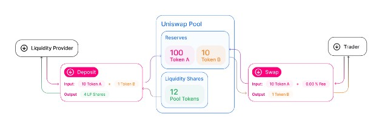
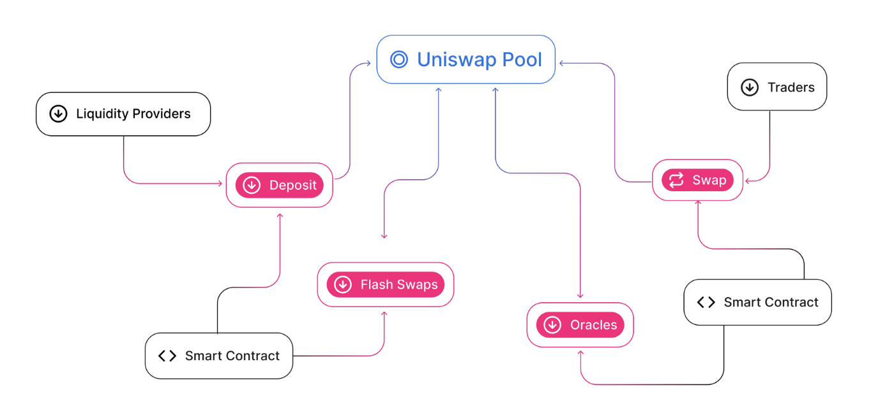
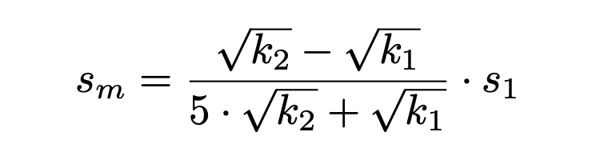

* * *

## Uniswap V2

### Intro.

在 2018 年 Uniswap 以一種 POC 的方式問世之後，2020 年 Uniswap V2 也被釋出，當前最新的版本則是 2021 釋出的 Uniswao V3。

在 Uniswap V2 運作的過程中，主要是由數個 ERC-20 代幣的交易對（Pairs）組成的 Liquidity Pool 組成。也就是說並不是交易者（Traders）一對一的進行交易，而是藉由 Uniswap 提供的 Route 將 traders 和 liquidity providers 導至 Liquidity Pool 進行各種交易。



> Source: [Uniswap V2 Overview](https://docs.uniswap.org/protocol/V2/concepts/protocol-overview/how-uniswap-works)

### Comparison with V1

1.  Uniswap v2 contracts are written in Solidity rather than Vyper.
2.  V1 中實際上沒辦法直接讓 ERC-20 和 ERC-20 進行互換，而是透過 ETH 作為中間者進行交易，V2 則可直接以 ERC-20 代幣之間的 Pair 進行 Swap。在 V1 中交易者要付更多的手續費（兩次），也需要承擔滑價的風險。
3.  在 V2 中 ETH 被改以 Weth 取代。
4.  Flash Swap:
    -   Anyone can withdraw as much of any ERC20 token they want as long as they:-
    -   pay all of that in the same transaction
    -   can pay the gas and platform fees.
    -   borrowing the tokens from the pool first then returning them back within the same transaction. This introduces the possibility that swapping tokenA for tokenB might end up receiving some additional tokenA, in which case fee should also be charged.

### Role in V2



### Uniswap Code Example in [Solidity by Example](https://solidity-by-example.org/defi/uniswap-v2/)

看完上述和 V1 的差別之後可以用以下這個極簡的程式碼例子快速了解一下差異。

```solidity
// SPDX-License-Identifier: MIT
pragma solidity ^0.8.13;

contract TestUniswap {
    address private constant UNISWAP_V2_ROUTER =
        0x7a250d5630B4cF539739dF2C5dAcb4c659F2488D;
    address private constant WETH = 0xC02aaA39b223FE8D0A0e5C4F27eAD9083C756Cc2;

    function swap(
        address _tokenIn,
        address _tokenOut,
        uint _amountIn,
        uint _amountOutMin,
        address _to
    ) external {
        IERC20(_tokenIn).transferFrom(msg.sender, address(this), _amountIn);
        IERC20(_tokenIn).approve(UNISWAP_V2_ROUTER, _amountIn);

        address[] memory path;
        if (_tokenIn == WETH || _tokenOut == WETH) {
            path = new address[](2);
            path[0] = _tokenIn;
            path[1] = _tokenOut;
        } else {
            path = new address[](3);
            path[0] = _tokenIn;
            path[1] = WETH;
            path[2] = _tokenOut;
        }

        IUniswapV2Router(UNISWAP_V2_ROUTER).swapExactTokensForTokens(
            _amountIn,
            _amountOutMin,
            path,
            _to,
            block.timestamp
        );
    }
}

interface IUniswapV2Router {
    function swapExactTokensForTokens(
        uint amountIn,
        uint amountOutMin,
        address[] calldata path,
        address to,
        uint deadline
    ) external returns (uint[] memory amounts);
}

interface IERC20 {
    function totalSupply() external view returns (uint);

    function balanceOf(address account) external view returns (uint);

    function transfer(address recipient, uint amount) external returns (bool);

    function allowance(address owner, address spender) external view returns (uint);

    function approve(address spender, uint amount) external returns (bool);

    function transferFrom(
        address sender,
        address recipient,
        uint amount
    ) external returns (bool);
}
```

* * *

## Contract Breakdown

V2 的主要功能有管理資金、交易代幣、流動性抵押與獲得報酬、管理 Pool 中的治理代幣、協議手續費。除了以上的主要功能 Uniswap V2 還有各種額外功能，例如：Price oracle，可以讓以太坊上的其他合約調用到這些代幣蠻真實的市場價格。

Code 的部分主要由四個合約組成，分成兩個主要部分：Core 和 Periphery。

-   **Core:** 主要用來儲存 Funds 和提供可使用的函式，包含以下：
    1.  **Pair** — 是一個實作 swapping, minting, burning tokens 的合約，每一個 ERC-20 代幣交易對都會有一個 `Pair Contract`
    2.  **Factory** — 用於創建和儲存所有 Pair Contract 的紀錄
    3.  **ERC20** — 記錄每一個 Pool 的擁有權。當 liquidity providers 將資金投入 pool 之後，他們就會得到 “pool ownership tokens”，也就是 `LP tokens` 作為獎勵。當 liquidity providers 想要贖回他們在 pool 中的資金，只要把這些 `LP tokens` 交回就可以得到原本的資金還有額外累積的獎勵報酬。
-   **Periphery:** 主要用於和 **Core** 進行互動：
    1.  **Router** — 提供一些和 **Core** 互動與連結的函式，例如 `addLiquidity`, `swapExactETHForTokens`, `swapETHForExactTokens` 等。

### Core - Pair

> Source: [Uniswap/v2-core/contracts/UniswapV2Pair.sol](https://github.com/Uniswap/v2-core/blob/master/contracts/UniswapV2Pair.sol)

```solidity
pragma solidity =0.5.16;

import './interfaces/IUniswapV2Pair.sol';
import './UniswapV2ERC20.sol';
import './libraries/Math.sol';
import './libraries/UQ112x112.sol';
import './interfaces/IERC20.sol';
import './interfaces/IUniswapV2Factory.sol';
import './interfaces/IUniswapV2Callee.sol';

contract UniswapV2Pair is IUniswapV2Pair, UniswapV2ERC20 {
    using SafeMath  for uint;
    using UQ112x112 for uint224;

    uint public constant MINIMUM_LIQUIDITY = 10**3;
    bytes4 private constant SELECTOR = bytes4(keccak256(bytes('transfer(address,uint256)')));
```

首先是宣告版本、Import 套件，以及宣告合約、繼承和宣告常數（例如 0.3% fee per trade），比較特別的有兩個：`IUniswapV2Pair` 是一個可用於管理 LP Token 的 Interface，和 `UQ112x112` 是用於支援浮點數的 SafeMath Library。

```solidity
    function _safeTransfer(address token, address to, uint value) private {
        (bool success, bytes memory data) = token.call(abi.encodeWithSelector(SELECTOR, to, value));
        require(success && (data.length == 0 || abi.decode(data, (bool))), 'UniswapV2: TRANSFER_FAILED');
    }
```

此外，`SELECTOR` 則是未來在以 `call` 進行 Low-Level 呼叫時會使用到的常數。

```solidity
    address public factory;
    address public token0;
    address public token1;

    uint112 private reserve0;           // uses single storage slot, accessible via getReserves
    uint112 private reserve1;           // uses single storage slot, accessible via getReserves
    uint32  private blockTimestampLast; // uses single storage slot, accessible via getReserves

    uint public price0CumulativeLast;
    uint public price1CumulativeLast;
    uint public kLast; // reserve0 * reserve1, as of immediately after the most recent liquidity event
```

程式碼中以 `Token0` 和 `Token1` 呈現兩個代幣，`reserve0` 和 `reserve1` 則是代表 Pair 中還剩下多少。簡單來說 `reserve0` 就是 `balanceOf(token0)`。有相關的 Getter Function:

```solidity
    function getReserves() public view returns (uint112 _reserve0, uint112 _reserve1, uint32 _blockTimestampLast) {
        _reserve0 = reserve0;
        _reserve1 = reserve1;
        _blockTimestampLast = blockTimestampLast;
    }
```

而這個 `reserve` 將會在之後的 `_update()` 於每一個 block 和 price accumulators 時更新。 比較重要的是裡面檢查 overflow 的實作方式，以及節省 gas 的方式：使用 `_reserve` 而非 `reserve`。

```solidity
    // update reserves and, on the first call per block, price accumulators
    function _update(uint balance0, uint balance1, uint112 _reserve0, uint112 _reserve1) private {
        require(balance0 <= uint112(-1) && balance1 <= uint112(-1), 'UniswapV2: OVERFLOW');
        uint32 blockTimestamp = uint32(block.timestamp % 2**32);
        uint32 timeElapsed = blockTimestamp - blockTimestampLast; // overflow is desired
        if (timeElapsed > 0 && _reserve0 != 0 && _reserve1 != 0) {
            // * never overflows, and + overflow is desired
            price0CumulativeLast += uint(UQ112x112.encode(_reserve1).uqdiv(_reserve0)) * timeElapsed;
            price1CumulativeLast += uint(UQ112x112.encode(_reserve0).uqdiv(_reserve1)) * timeElapsed;
        }
        reserve0 = uint112(balance0);
        reserve1 = uint112(balance1);
        blockTimestampLast = blockTimestamp;
        emit Sync(reserve0, reserve1);
    }
```

其中這個部分就是實作 Price Oracle 的程式碼，簡單來說就是利用兩點之間的差來除以 `timeElapsed`：

```solidity
        uint32 blockTimestamp = uint32(block.timestamp % 2**32);
        uint32 timeElapsed = blockTimestamp - blockTimestampLast; // overflow is desired
        if (timeElapsed > 0 && _reserve0 != 0 && _reserve1 != 0) {
            // * never overflows, and + overflow is desired
            price0CumulativeLast += uint(UQ112x112.encode(_reserve1).uqdiv(_reserve0)) * timeElapsed;
            price1CumulativeLast += uint(UQ112x112.encode(_reserve0).uqdiv(_reserve1)) * timeElapsed;
        }
```

想要更深入了解 Price Oracle 可以看這個超棒的教學：[Uniswap V2 Price Oracle | DeFi](https://www.youtube.com/watch?v=Ar4Ik7Bov0U&ab_channel=SmartContractProgrammer)

接下來我們看 `Minting` 和 `Burning`，我們會發現這些函式與 `Swap` 的最後都會進行 `_update` 更新。

當 Liquidity Provider 將資金投入 Pool 之後，`Mint` 函式就會被啟動用於鑄造 LP Token(pool ownership tokens)。反之當 Liquidity Provider 想要將資金提領出來時，就會起動 `Burn` 來將其 LP Token 燒毀。

```solidity
    // this low-level function should be called from a contract which performs important safety checks
    function mint(address to) external lock returns (uint liquidity) {
        (uint112 _reserve0, uint112 _reserve1,) = getReserves(); // gas savings
        uint balance0 = IERC20(token0).balanceOf(address(this));
        uint balance1 = IERC20(token1).balanceOf(address(this));
        uint amount0 = balance0.sub(_reserve0);
        uint amount1 = balance1.sub(_reserve1);

        bool feeOn = _mintFee(_reserve0, _reserve1);
        uint _totalSupply = totalSupply; // gas savings, must be defined here since totalSupply can update in _mintFee
        if (_totalSupply == 0) {
            liquidity = Math.sqrt(amount0.mul(amount1)).sub(MINIMUM_LIQUIDITY);
           _mint(address(0), MINIMUM_LIQUIDITY); // permanently lock the first MINIMUM_LIQUIDITY tokens
        } else {
            liquidity = Math.min(amount0.mul(_totalSupply) / _reserve0, amount1.mul(_totalSupply) / _reserve1);
        }
        require(liquidity > 0, 'UniswapV2: INSUFFICIENT_LIQUIDITY_MINTED');
        _mint(to, liquidity);

        _update(balance0, balance1, _reserve0, _reserve1);
        if (feeOn) kLast = uint(reserve0).mul(reserve1); // reserve0 and reserve1 are up-to-date
        emit Mint(msg.sender, amount0, amount1);
    }
```

在 `Mint` Function 中 `liquidity` 代表將要被鑄造給 Liquidity Provider 的 LP Token 數量。當 Provider 想要投注資金到 Pool 時會呼叫：`transfer(from: liquidity provider’s address, to: Pair contract’s address, amount)`。

`Burn` 則是 `Mint` 的鏡像。

```solidity
    // this low-level function should be called from a contract which performs important safety checks
    function burn(address to) external lock returns (uint amount0, uint amount1) {
        (uint112 _reserve0, uint112 _reserve1,) = getReserves(); // gas savings
        address _token0 = token0;                                // gas savings
        address _token1 = token1;                                // gas savings
        uint balance0 = IERC20(_token0).balanceOf(address(this));
        uint balance1 = IERC20(_token1).balanceOf(address(this));
        uint liquidity = balanceOf[address(this)];

        bool feeOn = _mintFee(_reserve0, _reserve1);
        uint _totalSupply = totalSupply; // gas savings, must be defined here since totalSupply can update in _mintFee
        amount0 = liquidity.mul(balance0) / _totalSupply; // using balances ensures pro-rata distribution
        amount1 = liquidity.mul(balance1) / _totalSupply; // using balances ensures pro-rata distribution
        require(amount0 > 0 && amount1 > 0, 'UniswapV2: INSUFFICIENT_LIQUIDITY_BURNED');
        _burn(address(this), liquidity);
        _safeTransfer(_token0, to, amount0);
        _safeTransfer(_token1, to, amount1);
        balance0 = IERC20(_token0).balanceOf(address(this));
        balance1 = IERC20(_token1).balanceOf(address(this));

        _update(balance0, balance1, _reserve0, _reserve1);
        if (feeOn) kLast = uint(reserve0).mul(reserve1); // reserve0 and reserve1 are up-to-date
        emit Burn(msg.sender, amount0, amount1, to);
    }
```

`Swap` 用於給 Traders 進行代幣 swap，裡面節省 Gas 的方式很適合學習。

```solidity
    // this low-level function should be called from a contract which performs important safety checks
    function swap(uint amount0Out, uint amount1Out, address to, bytes calldata data) external lock {
        require(amount0Out > 0 || amount1Out > 0, 'UniswapV2: INSUFFICIENT_OUTPUT_AMOUNT');
        (uint112 _reserve0, uint112 _reserve1,) = getReserves(); // gas savings
        require(amount0Out < _reserve0 && amount1Out < _reserve1, 'UniswapV2: INSUFFICIENT_LIQUIDITY');

        uint balance0;
        uint balance1;
        { // scope for _token{0,1}, avoids stack too deep errors
        address _token0 = token0;
        address _token1 = token1;
        require(to != _token0 && to != _token1, 'UniswapV2: INVALID_TO');
        if (amount0Out > 0) _safeTransfer(_token0, to, amount0Out); // optimistically transfer tokens
        if (amount1Out > 0) _safeTransfer(_token1, to, amount1Out); // optimistically transfer tokens
        if (data.length > 0) IUniswapV2Callee(to).uniswapV2Call(msg.sender, amount0Out, amount1Out, data);
        balance0 = IERC20(_token0).balanceOf(address(this));
        balance1 = IERC20(_token1).balanceOf(address(this));
        }
        uint amount0In = balance0 > _reserve0 - amount0Out ? balance0 - (_reserve0 - amount0Out) : 0;
        uint amount1In = balance1 > _reserve1 - amount1Out ? balance1 - (_reserve1 - amount1Out) : 0;
        require(amount0In > 0 || amount1In > 0, 'UniswapV2: INSUFFICIENT_INPUT_AMOUNT');
        { // scope for reserve{0,1}Adjusted, avoids stack too deep errors
        uint balance0Adjusted = balance0.mul(1000).sub(amount0In.mul(3));
        uint balance1Adjusted = balance1.mul(1000).sub(amount1In.mul(3));
        require(balance0Adjusted.mul(balance1Adjusted) >= uint(_reserve0).mul(_reserve1).mul(1000**2), 'UniswapV2: K');
        }

        _update(balance0, balance1, _reserve0, _reserve1);
        emit Swap(msg.sender, amount0In, amount1In, amount0Out, amount1Out, to);
    }
```

在每一個 Pair Contract 裡面都會有一個能夠 on/off 的 Protocol Fee 機制存在，Traders 會付出六分之一的手續費。

```solidity
    // if fee is on, mint liquidity equivalent to 1/6th of the growth in sqrt(k)
    function _mintFee(uint112 _reserve0, uint112 _reserve1) private returns (bool feeOn) {
        address feeTo = IUniswapV2Factory(factory).feeTo();
        feeOn = feeTo != address(0);
        uint _kLast = kLast; // gas savings
        if (feeOn) {
            if (_kLast != 0) {
                uint rootK = Math.sqrt(uint(_reserve0).mul(_reserve1));
                uint rootKLast = Math.sqrt(_kLast);
                if (rootK > rootKLast) {
                    uint numerator = totalSupply.mul(rootK.sub(rootKLast));
                    uint denominator = rootK.mul(5).add(rootKLast);
                    uint liquidity = numerator / denominator;
                    if (liquidity > 0) _mint(feeTo, liquidity);
                }
            }
        } else if (_kLast != 0) {
            kLast = 0;
        }
    }
```

實際計算 Protocol Fee 的公式可以在[白皮書中](https://uniswap.org/whitepaper.pdf)找到：



其中 `kLast` 是乘積函式中的常數 K。

`lock` 會確保合約中的兩個部分不會被同時執行，也就是防範 Eeentrancy Attack。

```solidity
    uint private unlocked = 1;
    modifier lock() {
        require(unlocked == 1, 'UniswapV2: LOCKED');
        unlocked = 0;
        _;
        unlocked = 1;
    }

    // force balances to match reserves
    function skim(address to) external lock {
        address _token0 = token0; // gas savings
        address _token1 = token1; // gas savings
        _safeTransfer(_token0, to, IERC20(_token0).balanceOf(address(this)).sub(reserve0));
        _safeTransfer(_token1, to, IERC20(_token1).balanceOf(address(this)).sub(reserve1));
    }

    // force reserves to match balances
    function sync() external lock {
        _update(IERC20(token0).balanceOf(address(this)), IERC20(token1).balanceOf(address(this)), reserve0, reserve1);
    }
```

`skim` 和 `sync` 用於更新 Reserve 變數和避免有人無目的的把資金轉入合約（用於提領多餘的資金）。

### Core - ERC20

> Source: [Uniswap/v2-core/contracts/UniswapV2ERC20.sol](https://github.com/Uniswap/v2-core/blob/master/contracts/UniswapV2ERC20.sol)

其實就是一個 ERC-20 的介面標準，用於 liquidity providers 鑄造、燒毀或者獲得額外報酬的 LP Token。

### Core - Factory

> Source: [Uniswap/v2-core/contracts/UniswapV2Fatory.sol](https://github.com/Uniswap/v2-core/blob/master/contracts/UniswapV2Factory.sol)

創建一個 Token A 和 Token B 的 Pair Contract，創建的方法是使用 `create2(0, add(bytecode, 32), mload(bytecode), salt)`。

```solidity
    function createPair(address tokenA, address tokenB) external returns (address pair) {
        require(tokenA != tokenB, 'UniswapV2: IDENTICAL_ADDRESSES');
        (address token0, address token1) = tokenA < tokenB ? (tokenA, tokenB) : (tokenB, tokenA);
        require(token0 != address(0), 'UniswapV2: ZERO_ADDRESS');
        require(getPair[token0][token1] == address(0), 'UniswapV2: PAIR_EXISTS'); // single check is sufficient
        bytes memory bytecode = type(UniswapV2Pair).creationCode;
        bytes32 salt = keccak256(abi.encodePacked(token0, token1));
        assembly {
            pair := create2(0, add(bytecode, 32), mload(bytecode), salt)
        }
        IUniswapV2Pair(pair).initialize(token0, token1);
        getPair[token0][token1] = pair;
        getPair[token1][token0] = pair; // populate mapping in the reverse direction
        allPairs.push(pair);
        emit PairCreated(token0, token1, pair, allPairs.length);
    }
```

### Periphery - Router

> Source: [Uniswap/v2-periphery](https://github.com/Uniswap/v2-periphery)

Periphery contract 是 Uniswap 的 API，當然我們也可以直接呼叫 Core Contract 只是那將會非常麻煩（和危險）。裡面會實作許多 User 會遇到的函式，例如：adding/removing liquidity 和 swapping tokens。

為了要避免搶先交易的問題，V2 實作了 `amountOutMin` 和 `deadline` 兩個參數在函式中。當某些情況發生時，例如 Front Running Problem 或者競爭條件（race condition）發生，導致數量低於特定的 `amountOutMin` 時，或者交易在 `deadline` block 之後才發生，這個交易就會被 `revert` 並且不會有任何代幣被轉移。

* * *

## Closing

### Reference

-   [Dev. Doc - The Uniswap V2 Protocol](https://docs.uniswap.org/protocol/V2/introduction)

* * *

> 最後歡迎大家拍打餵食大學生[`0x2b83c71A59b926137D3E1f37EF20394d0495d72d`](https://etherscan.io/address/0x2b83c71A59b926137D3E1f37EF20394d0495d72d)
