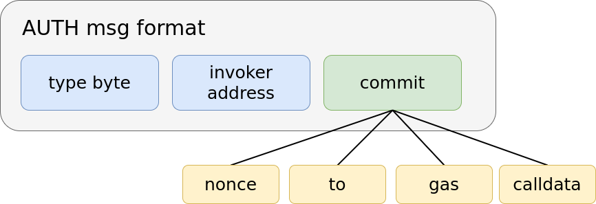
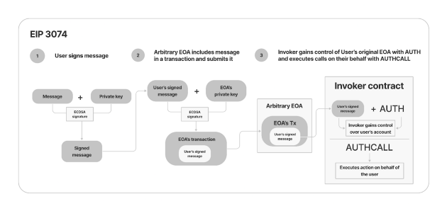
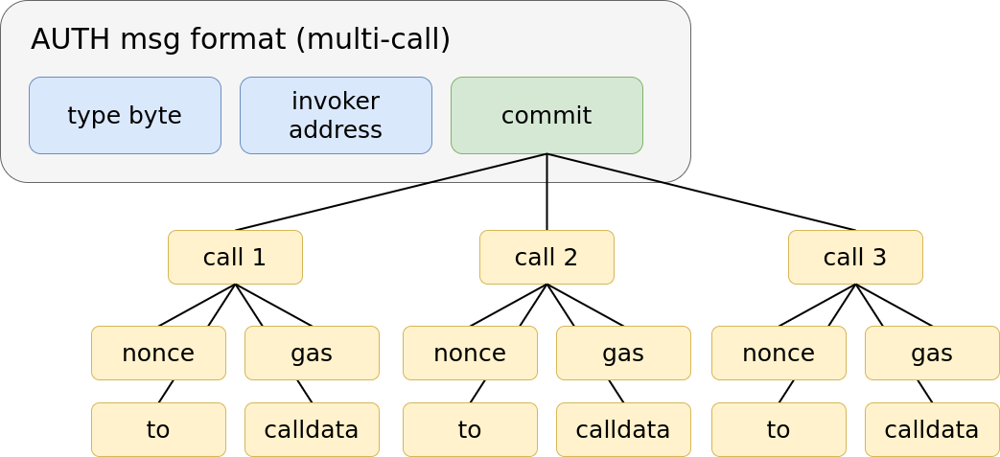
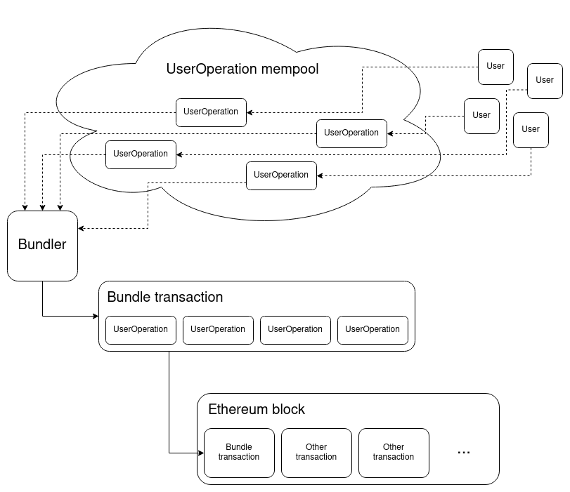
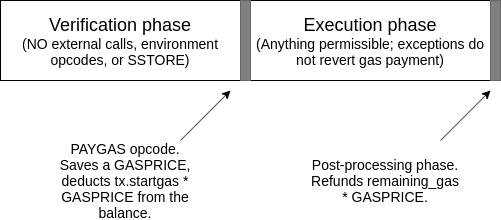
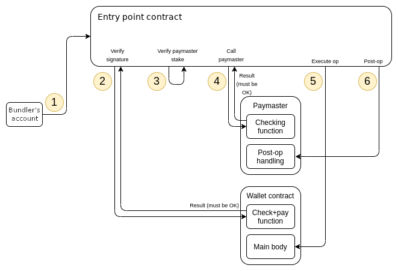
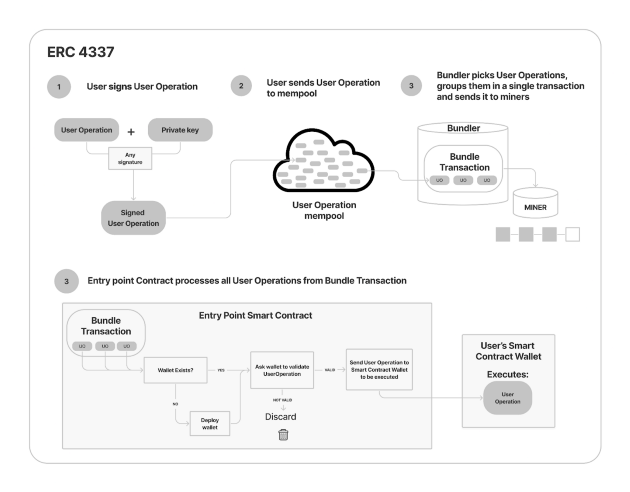

# Account Abstraction 抽象帳戶：EIP-3074 與 EIP-4337 簡介

###### tags: `TOPIC`

以太坊的社群其實討論了好一陣子究竟要如何設計新一代的帳戶，不同的思路也對應了不同的提案，本文主要介紹 AA 在以下這兩種方向的相關內容：

1.  讓現行的 EOA 有智能合約的功能（EIP-3074）
2.  讓現行的智能合約有 EOA 的功能（EIP-4337）

### Table of Contents

-   EIP-3074
-   EIP-4337
-   Closing

### Background

本文主要繼承自前篇：[***Account Abstraction 抽象帳戶：EIP-2938 簡介***](https://medium.com/taipei-ethereum-meetup/account-abstraction-%E6%8A%BD%E8%B1%A1%E5%B8%B3%E6%88%B6-eip-2938-%E7%B0%A1%E4%BB%8B-edfd64fac767)，因此會希望讀者已經閱讀完前篇，以及具備相關的背景知識。

* * *

## EIP-3074

[EIP-3074: AUTH and AUTHCALL opcodes](https://eips.ethereum.org/EIPS/eip-3074) 打算在 EVM 中加入兩個新的 OpCodes，分別是 `AUTH` 和 `AUTHCALL`，讓智能合約可以代理 EOA 去對一筆交易（call）進行提交。

> 此提案仍在 review 階段，請大家謹慎服用。

EIP-3074 的主要目的並非設計一個嶄新的 protocol 來擴展 EOA 的 functionality，因為隨著 protocol 與相關的介面標準越來越複雜，能被攻擊的地方也會越來越多。

它傾向讓 User（EOA）可以以合約（Invoker Contract）代理自己執行各種動作，同時讓開發者能以一個更具彈性的框架來設計交易物件和驗證機制（簽章演算法），使任何的 EOA 可以像一個合約帳戶（Contract Account）一樣運作，卻不用自己佈署任何合約。

### authorized

-   `authorized` 是一個型態為 `address` 的變數（Context Variables），表示當今合約是被哪個帳戶授權的。被授權的合約能夠使用 `AUTHCALL` 代表此帳戶（`authorized` 的 `address`）執行各種行為。
-   合約每一次只能有一個 `authorized`，也就是說合約不能同時代替兩個 EOA 執行動作。
-   合約每次執行時（separate execution frames），每次的 `authorized` 是獨立的，不能監聽到別人的 `authorized`。即便是利用`DELEGATECALL`，或同樣 `address` 授權加上同樣一筆交易，當前 `authorized` 都不能離開作用域影響別人。
-   `authorized` 和其他以太坊中的變數不同，它沒有預設值，每次合約開始一個執行前就會將其初始化為 `unset`，代表當前沒有 EOA 授權此合約執行。

### AUTH 和 AUTHCALL

**AUTH**（`0xf6`）：會基於 ECDSA 簽章演算法去設定 `authorized` 的值

-   `AUTH` 會從 Stack 中取出三個元素：`authority`、`offset`、`length`，首項代表 signer address，後兩者代表 memory 的 range，會接收 EOA 的 （`yParity`, `r`, `s`） 以及 `commit`。
-   由於是接收 dynamic memory range，因此 `AUTH` 未來是有機會升級來支援與 Contract Account 互動或使用其他驗證方法的。
-   此處 EOA 送來的簽章仍然是使用 `secp256k1` 這個演算法，待簽的 Msg. Hash 為：`keccak256(MAGIC || chainId || paddedInvokerAddress || commit)`，簽章結果為：`(yParity, r, s)`。
-   如果**簽章合法且簽章 recover 後 `authority == signer`** 或 `authority == tx.origin`（供此 EIP 實作之前的交易使用），則將 `authorized` 設為 `authority`。
-   如果 `authorized` 被成功設定成 `authority` 也就是 `signer`，那 `AUTH` 會回傳 `1`，否則回傳 `0`。
-   `commit` 是 EOA 提交的交易資訊，Invoker Contract 會驗證這裡面的內容，包含 `nonce`（replay protection）、`to`、`gas`、`calldata`。

**AUTHCALL**（`0xf7`）：會代理 `authorized` 這個帳戶發送 call

-   `AUTHCALL` 會從 Stack 中取出八個元素，包含：`gas`、`addr`、`value` 等，用於發送 call（建置一筆交易物件）。
-   與 `CALL(0xF1)` 的行為很像，差別主要在於一些參數的邏輯判斷，例如： `authorized` 如果是 unset 的狀態，則這次執行動作就不合法。

在 EIP-3074 中還有 `dynamic_gas` 的設計，這個部份因為比較瑣碎我就先略過，如果有興趣或是想知道其他參數的 Spec. 可以詳閱[此處](https://eips.ethereum.org/EIPS/eip-3074#specification)。

### Overview

> Image Source: [Ethereum wallets today and tomorrow — EIP-3074 vs. ERC-4337](https://medium.com/nethermind-eth/ethereum-wallets-today-and-tomorrow-eip-3074-vs-erc-4337-a7732b81efc8)

概括來說一個 EOA 能將一則已簽的訊息（交易）送至**自己信任的合約**（稱作 Invoker）上，合約可以利用 `AUTH` 和 `AUTHCALL` 代替這個 EOA 送出這筆交易，此時負擔 Gas Fee 的便是 Contract 但交易之中的簽章來自於 EOA。

由於 EOA / User 提交給 Invoker 的形式是合約自訂的，所以能讓各種需求變得很好實現，例如批次交易、包裝交易、手續費繳交方式、多簽、簽章驗證方式等。EOA 也能透過他喜歡的方式（ERC-20、法幣等）給予 Invoker Contract 手續費。

> 特別注意：
> 
> 1.  EIP-3074 可以視為是 EOA 的擴充而非必要。
> 2.  Invoker 是**不可升級的**，因為可升級合約可能會讓 Invoker 無法適當地驗證 `commit`。

此外，`commit` 可以利用平行的 call 和在其之中的 nonce，達到 multi-call 的「包裝交易」效果。例如我們在面對 ERC-20 的交易時，就可以把 `approve`\-`transfer` 包在一個動作裡面。

> EIP-3074 相關的缺點與改進建議的部分可以看：[*A case for a simpler alternative to EIP 3074*](https://ethereum-magicians.org/t/a-case-for-a-simpler-alternative-to-eip-3074/6493)、[*EIP-3074 Threat Models*](https://hackmd.io/@matt/BknnAnyNu) 和 Reference 處的內容。

* * *

## EIP-4337

[EIP-4337: Account Abstraction via Entry Point Contract specification](https://eips.ethereum.org/EIPS/eip-4337) 則希望可以把原本交易在底層運作的邏輯拉到合約中：

1.  當 User 簽核完一筆交易（這裡我們將 EOA 簽送一筆交易的行為改稱為 UserOperation）後
2.  將其送到 UserOperation mempool 之中（類似當今的 Tx Mempool）
3.  而 Bundler 會從中挑選交易，綑綁成一筆 Bundle Transaction
4.  呼叫 Entry Point Smart Contract 的 `handleOps`
5.  完成相關執行與驗證之後，把交易推到鏈上。

在這裡我們有許多名詞是第一次碰到，下文我會慢慢解釋！

> 此提案仍在 draft 階段，請大家謹慎服用。

> Source: [ERC 4337: account abstraction without Ethereum protocol changes](https://medium.com/infinitism/erc-4337-account-abstraction-without-ethereum-protocol-changes-d75c9d94dc4a)

首先，這個提案最大的特點就如同上圖來源， Vitalik 文章的標題敘述一樣，不用去更改 Ethereum 底層的 Protocol 就能完成 AA 的實作。

> 嚴謹來說是不用去修改或增加共識層的 Protocol。

EIP-4337 可以達到以下目標，某些點可能與我們之前介紹過的 EIP-2938 和 EIP-3074 稍微不同：

1.  **以 Contract Account 作為真正的主要帳戶：** 不再需要任何 EOA 作為呼叫的源頭（當今的 Contract Account 和 EIP-3074 都無法達到）
2.  **去中心化：** 不需要對 bundler 這個角色的信任假設
3.  **不需要修改共識層的 Protocol：** 所以不會有新的 OpCodes 也不會有新的 Transaction Type。
4.  擁有過往我們提到的其他特性，例如：Atomic multi-operations、Privacy-Solution、不同支付手續費的方式（ERC-20）

### Contract Specification

我們可以把 EIP-4337 的 AA 實作當成是一個 Contract 的 Spec.，它的目的是要把底層的交易與帳戶運作拉到合約層面執行。這邊我會邊解釋名詞，邊順過整個交易在 AA 被執行的過程。

#### 1\. UserOperation & 2. UserOperation mempool

在合約裡面，用戶送上來的交易物件是一個在合約中名為 `UserOperation` 的 `struct`。這個 `struct` 的 members 和我們認識的交易很像，包含 `sender`、`nonce`、`callData`、`callGas`、`signature` 等，細節可見[原提案](https://eips.ethereum.org/EIPS/eip-4337#specification)。

> 為了避免 Replay Attack（跨鏈或跨不同的 EntryPoint），Signature 的製作必須要包含 `chainid` 和 `EntryPoint address` 等元素。

#### 3\. Bundler & 4. Bundle Transaction

Bundler 有可能是礦工，或是能作為 User 和 Miner 之間的中介人。會去聆聽 UserOperation mempool 中新加入的 `UserOperation`，並且將從這些交易中挑選一部分綑綁成 Bundle Transactions。

> 這邊我們可以假設 UserOperation 一定會被打包處理，因為可能會有類似 Flash Bot 的 Bundler 去快速過濾出有利潤（手續費）可圖的交易。

首先 Bundler 會在 Local 使用 RPC Call 呼叫 Entry Point Smart Contract 中的 `simulateValidation()`，以此先確保這些 UserOperation 的簽章沒問題和 Gas Fee 被正常支付。關於模擬交易結果的部分可見[此處](https://eips.ethereum.org/EIPS/eip-4337#simulation)。

最後 Bundle Transactions 會呼叫 Entry Point Smart Contract 中的函式 `handleOps`。

#### 5\. handleOps & 6. Entry Point Smart Contract

Entry Point Smart Contract（`EntryPoint`）是一個早就被佈署的合約，將在未來被相關的 AA Transaction 呼叫使用，例如某一個 Dapp 有它想要的 AA 交易模式，它就需要佈署一個它的 `EntryPoint`。

`EntryPoint` 會處理 UserOperations 的內容和替 Bundle Trandactions 佈署一個 Wallets Contract（使用標準 [EIP-2470: Singleton Factory](https://eips.ethereum.org/EIPS/eip-2470) 以及 `CREATE2`，`initCode` 來自於 `UserOperation.initCode` ，`salt` 來自於 `UserOperation.nonce`）。

Wallet Contract 會用來處理 nonce 與 signature 的驗證並且執行交易。

### Entry Point Smart Contract

在進到 `EntryPoint` 與 `handleOps` 的解釋之前，我們先回憶一下之前在 EIP-2938 提到的，節點需要負責驗證一筆 AA 交易是否合法的兩個階段：`PAYGAS` 以前的驗證階段（verification phase），與 `PAYGAS` 以後的執行階段（execution phase）。

-   前者限制交易只能閱讀合約的 storage（e.g. public keys, anti-replay nonces, Merkle roots） 以及不能更改任何狀態，如果交易在這個階段失敗，礦工會拒絕這筆交易。
-   後者因為已經支付了 fee，如果交易在這個階段失敗，礦工仍然可以選擇要不要加入這筆交易。

> Source: [Implementing account abstraction as part of eth1.x](https://ethereum-magicians.org/t/implementing-account-abstraction-as-part-of-eth1-x/4020)

在 `handleOps` 中有很類似的舉動，面對每一個 UserOperation，`handleOps` 會用兩個 For Loop 來實作上述兩個 phases，一個是 `verification loop`，另一個是 `execution loop`。

#### Verification Loop

1.  如果這個 `UserOperation` 還沒有一個對應的 wallet contract，就用 `UserOperation` 中的其中一個 field：`initCode`，來佈署一個合約。
2.  如果 `initCode` 是空的，或者佈署之後的 Wallet Contract Address 和 `UserOperation.sender` 不同，這個 call 就視為失敗。
3.  將 `UserOperation` 作為參數並且附上手續費，以呼叫 wallet contract 中的 `validateUserOp`
4.  `validateUserOp` 首先會用 `require(msg.sender == ENTRY_POINT)` 確認 `EntryPoint` 是自己認可的。接著驗證交易是否合法，包含我們上述提到的那些 AA 特性的驗證（multi-sig、social recovery、不同的 Sig. Algorithms 等）以及 nonce 是否正確。
5.  交易若是合法則 Wallet 收下手續費（對應到我們當初說的 `PAYGAS`）。以上過程中有任何失敗都會 revert。

> **補充說明：**
> 
> 1.  用戶在送上 `UserOperation` 這個物件時，必須先用 [EIP-1014](https://github.com/ethereum/EIPs/blob/master/EIPS/eip-1014.md) 自行計算 `UserOperation.sender`，也就是 `CREATE2` 創建的 Wallet Contract 的地址。
> 2.  `validateUserOp()` 和我們之前提到 Bundler 會預先呼叫 `EntryPoint` 的 `simulateValidation()` 要互相對應。
> 3.  需要特別注意 Verification Loop 中，wallet、paymaster 再去 call 時（depth > 2）有禁止執行的 OpCodes，這個部份對應到之前 EIP-2938 的「限制交易在 `PAYGAS` 之前只能閱讀合約自己的 storage 以及不能更改任何狀態」。

#### Execution Loop

`handleOps` 中的第二個步驟（迴圈）會以 `UserOperation` 作為 `calldata`，去呼叫 Verification Loop 佈署的 Wallet Contract。並且執行交易本身該執行的內容。

> 可想而知 Wallet Contract 要有辦法去 parse 這個 `calldata`。

執行完以後，會將剩餘的 gas fee 給予 Wallet Contract。

### Paymasters

在 EIP-4337 還有特別重要的一個 Features 叫做 **Paymasters**。

大家還記得在[之前的文章中](https://medium.com/taipei-ethereum-meetup/account-abstraction-%E6%8A%BD%E8%B1%A1%E5%B8%B3%E6%88%B6-eip-2938-%E7%B0%A1%E4%BB%8B-edfd64fac767)有介紹過的其他支付手續費的方式，以及 Tornado Cash 的 AA Example 嗎。Paymasters 可以做到第三方代替別人支付一筆交易的手續費的行為，此時就可以去接收其他種的 Fee（e.g. 信用卡、ERC-20 等）。

在以上的示意圖中，對應的步驟如下：

1.  Bundler 會呼叫 `EntryPoint` 的 `handleOps`。
2.  `EntryPoint` 將 `UserOperation` 作為參數呼叫 wallet contract 中的 `validateUserOp`，驗證所有交易該驗證的事情，**和上文介紹兩迴圈時不同的是：這邊不會支付手續費。**
3.  `handleOps`除了 `validateUserOp` 以外，還需要確認 Paymaster 的狀況，例如擁有足夠的 ETH 可以支付這筆交易的手續費。
4.  `EntryPoint` 呼叫 Paymaster Contract 中的 `validatePaymasterUserOp`，確認 paymaster 願意支付這筆交易的手續費。願意則支付 ERC-20，如果不願意這筆交易就會 failed。
5.  呼叫 Wallet Contract 並執行交易本身該執行的內容。
6.  做完第五步之後，必須緊接著呼叫 Paymaster Contract 的 `postOp`（利用包在 Internal Call 的方式讓五、六步無法分割）。

> > **補充說明：**
> 
> 1.  第一到第四步為 Verification Loop，第五與第六步為 Execution Loop。
> 2.  要如何判斷這筆交易的手續費是 Wallet Contract 還是 Paymasters 支付，得看 `validateUserOp` 中的參數 `requiredPrefund` 是否為 0。
> 3.  `EntryPoint` 必須要實作 `balanceOf`、`depositTo`、`withdrawTo` 等 method 來幫助 Paymaster 判斷相關狀態（e.g. `sender` 擁有足夠的 ERC-20 Balance）。
> 4.  為了防止 Paymasters 可能 DoS 系統的風險，我們需要一個 Paymaster 的聲望機制（reputation system） ，詳細可見：[*reputation, throttling and banning section*](https://eips.ethereum.org/EIPS/eip-4337#reputation-scoring-and-throttlingbanning-for-paymasters)。
> 5.  可以有多個 Paymasters 來分擔一筆交易的手續費。

下面這張圖也蠻漂亮的，大家可以參考一下：

> Image Source: [Ethereum wallets today and tomorrow — EIP-3074 vs. ERC-4337](https://medium.com/nethermind-eth/ethereum-wallets-today-and-tomorrow-eip-3074-vs-erc-4337-a7732b81efc8)

* * *

## Closing

和前一篇介紹 AA 的文章相同，由於是簡介所以非常多設計細節還有實作的設計想法我都沒有提到，如果想要了解的話可以細細品嘗該 EIP 本身還有下方 Reference 提到的資料。

由於以上介紹的兩個提案都還不是定案，在研究時也會找到許多舊版提案的內容，因此如果大家發現認知與資料不一的情況，可以先去確認 EIP 內文，那裏肯定是最準確的！

### Reference

#### EIP-3074

-   [Ethereum Magicians: EIP-3074: AUTH and AUTHCALL opcodes](https://ethereum-magicians.org/t/eip-3074-auth-and-authcall-opcodes/4880?page=4)
-   [We should be moving beyond EOAs, not enshrining them even further (EIP 3074-related)](https://ethereum-magicians.org/t/we-should-be-moving-beyond-eoas-not-enshrining-them-even-further-eip-3074-related/6538)
-   [EIP-3074 (Batch) Transaction Invoker](https://github.com/Mrtenz/transaction-invoker)
-   [EIP-3074 Invoker Examples](https://gist.github.com/adietrichs/ab69fa2e505341e3744114eda98a05ab)
-   [EIP-3074 Security Audit Report Ethereum Foundation](https://leastauthority.com/static/publications/LeastAuthority_Ethereum_Foundation_EIP-3074_Final_Audit_Report.pdf)
-   [PEEPanEIP #27: EIP-3074: Native Sponsored Transactions with Sam Wilson](https://www.youtube.com/watch?v=4A3N8dvdaSk&ab_channel=EthereumCatHerders)

#### EIP-4337

-   [Ethereum Magicians: ERC 4337: Account Abstraction via Entry Point Contract specification](https://ethereum-magicians.org/t/erc-4337-account-abstraction-via-entry-point-contract-specification/7160)
-   [Proposed initial abstraction changes for Metropolis](https://github.com/ethereum/EIPs/issues/86)
-   [stackupfinance/stackup](https://github.com/stackupfinance/stackup)
-   [eth-infinitism/account-abstraction](https://github.com/eth-infinitism/account-abstraction/tree/a2f4b7be4d9996095e08d7102bacc9f13ea99ff6)
-   [PEEPanEIP#65: EIP-4337: Account Abstraction via Entry Point Contract specs. with Yoav W., Kristof G.](https://www.youtube.com/watch?v=YXwKB0htrwM&ab_channel=EthereumCatHerders)
-   [EIP-4337 – Ethereum Account Abstraction Audit](https://blog.openzeppelin.com/eth-foundation-account-abstraction-audit/)

### Link Tree

-   [chihaolu.me](https://chihaolu.me)
-   [chihaolu.eth](https://chihaolu.eth.xyz)
